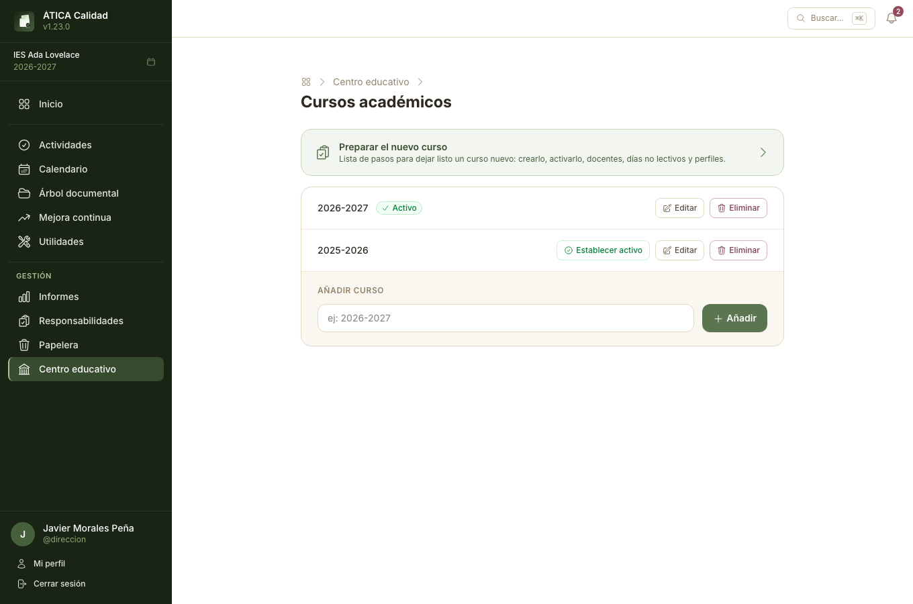
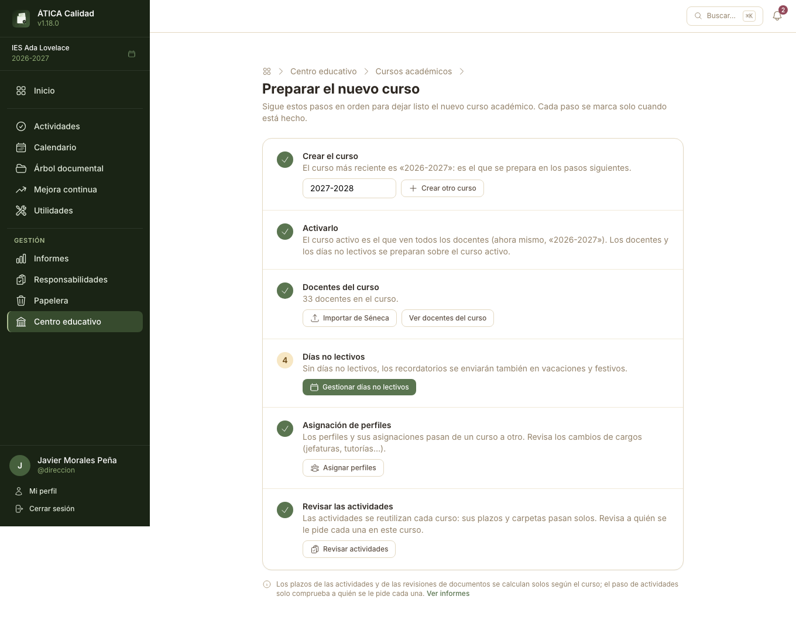
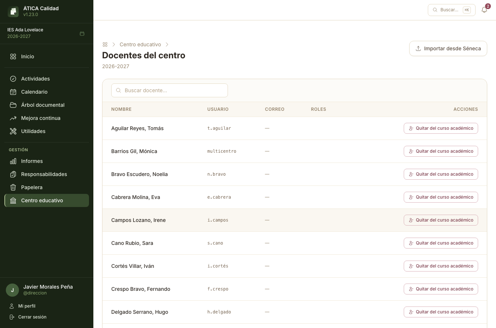
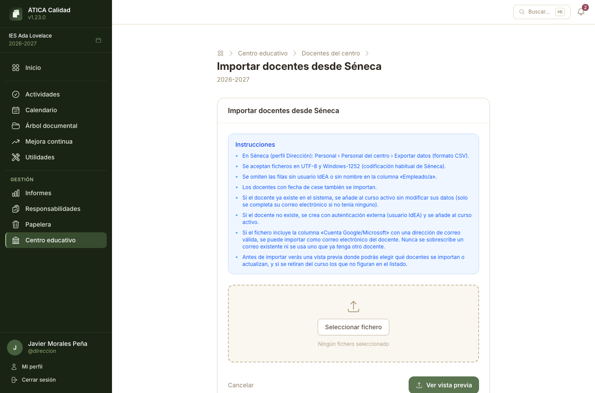
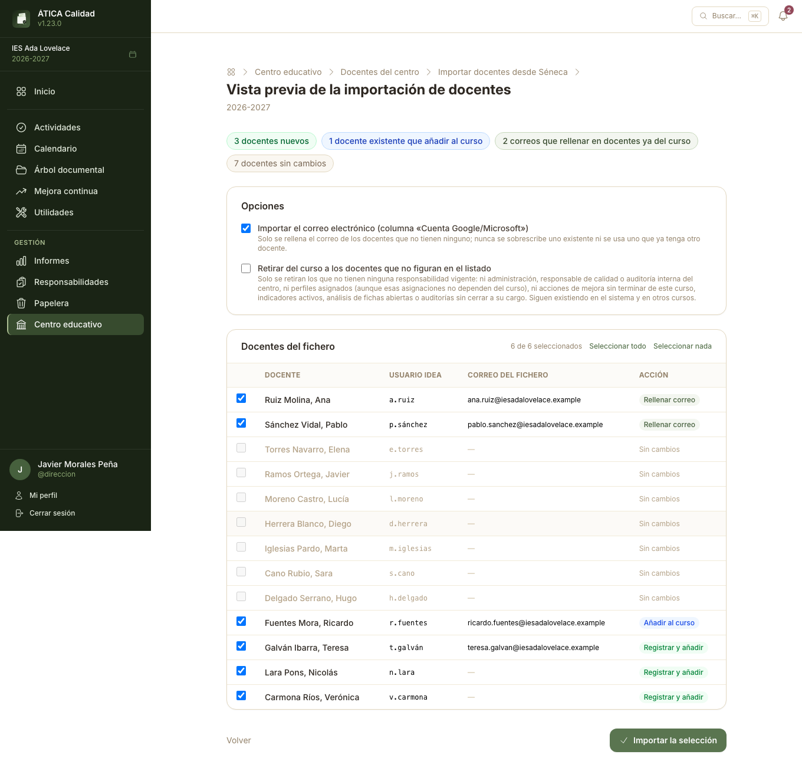
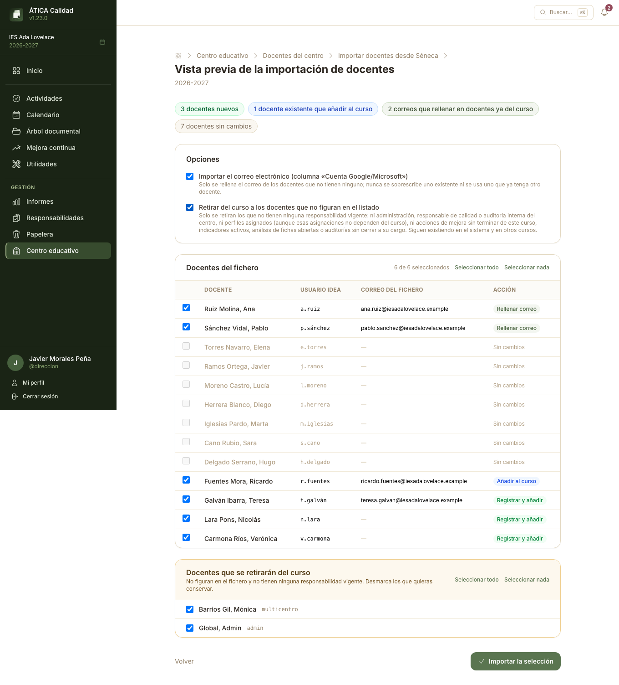
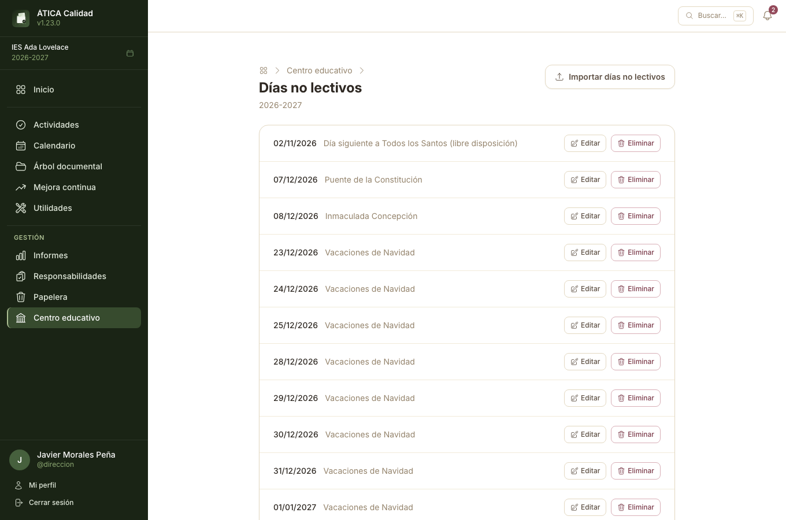
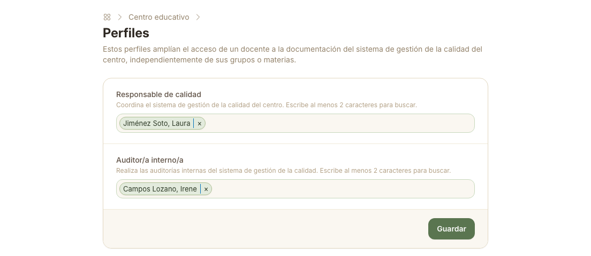
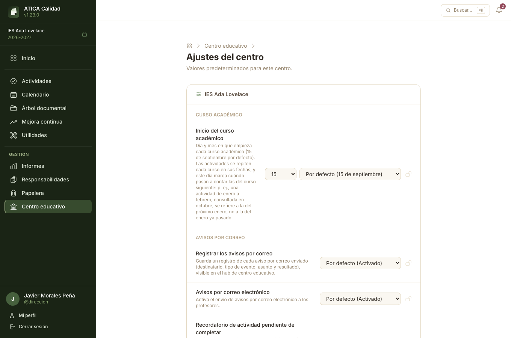

# Preparar el curso académico

Este capítulo es para el equipo directivo y la administración del centro. Antes de que el
profesorado pueda usar la aplicación con normalidad, conviene dejar preparados unos pocos datos
básicos del curso académico.

## Cursos académicos

Cada centro tiene uno o varios cursos académicos (p. ej. «2026-2027»), y siempre hay uno marcado
como **activo**: el que ve por defecto todo el profesorado al entrar. Desde
**Centro educativo → Cursos académicos** puedes crear el curso nuevo, activarlo cuando corresponda
y consultar los anteriores.

El curso con la etiqueta **Activo** es el que se ve por defecto. Para cambiarlo, **Establecer activo**
en el que corresponda (sin borrar nada: el anterior sigue consultable). Un curso nuevo se crea
escribiendo su nombre en **Añadir curso**; el nombre es libre, aunque la costumbre es «2026-2027».
Encima de la lista, **Preparar el nuevo curso** abre la lista de pasos que se describe a
continuación.

## Preparar el nuevo curso {#preparar-el-nuevo-curso}

Al principio de cada curso, lo más cómodo es seguir **Centro educativo → Cursos académicos →
Preparar el nuevo curso**: una lista de pasos, en el orden en que conviene darlos, que se marcan
solos cuando están hechos. Cada paso incluye su propio botón o un enlace a la página donde se hace:

1. **Crear el curso.** El nombre del siguiente ya aparece sugerido: si el último es «2025-2026»,
   propone «2026-2027» (y «2025/26» pasaría a «2026/27»). El curso que se prepara en los pasos
   siguientes es siempre el más reciente.
2. **Activarlo.** Desde ese momento, todo el profesorado trabaja en el curso nuevo. Los anteriores
   siguen disponibles para consultarlos. Los docentes y los días no lectivos se preparan ya sobre el
   curso activo, así que los pasos siguientes esperan a que lo actives.
3. **Docentes del curso.** Con **Copiar docentes** se añaden de un clic todos los docentes de un
   curso anterior; después basta con quitar a quien ya no esté. Si tienes el listado de Séneca,
   también puedes importarlo.
4. **Días no lectivos.** Sin ellos, los recordatorios por correo se envían también en vacaciones y
   festivos.
5. **Asignación de perfiles.** Los perfiles y sus asignaciones pasan de un curso a otro. Este paso
   lista las asignaciones de docentes que ya no están en el curso (una jefatura o una tutoría que
   sigue a nombre de alguien que se fue), para quitarlas o pasarlas a quien le sustituya.

Las actividades y las revisiones de documentos no necesitan preparación: sus plazos se calculan
solos según el curso.

## Docentes del centro

Desde **Centro educativo → Docentes del centro** añades al curso activo el profesorado que va a
trabajar con la aplicación este curso, bien buscando su usuario si ya existe en el sistema (de un
curso anterior o de otro centro), bien registrándolo, o importando el listado completo desde un CSV
exportado de Séneca.

La tabla lista a quienes pertenecen **al curso activo** (34 en los datos de demostración), con su
usuario, su correo y, si lo tienen, su papel en el centro. **Quitar del curso académico** retira a
un docente de este curso sin borrarlo del sistema ni de otros cursos. En la parte baja de la página,
**Añadir docente al curso académico** busca por usuario IdEA a quien ya existe; si no existe, ofrece
registrarlo.

### Importar el listado desde Séneca

La importación tiene dos pasos. Al subir el CSV (**Personal › Personal del centro › Exportar
datos**) no se cambia nada todavía: se muestra una **vista previa** con una casilla por docente
—todos marcados, con *Seleccionar todo* y *Seleccionar nada*— y lo que se haría con cada uno:
registrarlo y añadirlo al curso, añadirlo (si ya existía en el sistema) o solo rellenarle el correo.
Al confirmar se aplica únicamente lo que hayas dejado marcado.

La captura siguiente es la vista previa de un fichero de ejemplo con trece docentes. Los
resúmenes de arriba cuentan cada caso, y la columna **Acción** dice qué se hará con cada fila:

- **Registrar y añadir** (3 docentes nuevos): no existen en el sistema, se crean y entran en el curso.
- **Añadir al curso** (1): ya existía como usuario —por ejemplo, alguien que estuvo el curso pasado
  y volvió— y solo se incorpora a este curso.
- **Rellenar correo** (2): ya están en el curso y no tenían correo; el fichero trae uno.
- **Sin cambios** (7): ya están en el curso y no hay nada que actualizar; vienen desmarcados.

Dos opciones en la vista previa:

- **Importar el correo electrónico.** Si el fichero trae la columna *Cuenta Google/Microsoft*, se
  usa como correo del docente, pero solo cuando no tiene ninguno: nunca se sobrescribe uno
  existente ni se usa uno que ya tenga otro docente.
- **Retirar del curso a los docentes que no figuran en el listado.** Se muestra la lista de quienes
  se retirarían, para desmarcar a quien quieras conservar. Nunca se ofrece a quien tenga alguna
  responsabilidad vigente —administración, responsable de calidad o auditoría interna del centro,
  un perfil asignado, o una acción de mejora, indicador, análisis de ficha o auditoría abiertos a
  su cargo— ni a quien está importando. Los docentes retirados siguen existiendo en el sistema y en
  otros cursos.

En el ejemplo solo se ofrecen dos docentes para retirar, aunque el curso tiene 34 y el fichero trae
trece: casi todos los demás desempeñan algún perfil (tutorías, jefaturas...) y por eso **nunca** se
proponen. Los que salen aquí (la usuaria `multicentro` y el administrador de la plataforma) se
pueden desmarcar para conservarlos.

## Días no lectivos

Desde **Centro educativo → Días no lectivos** registras los festivos, puentes y días de libre
disposición del curso académico — se importan también desde el calendario oficial (.ics) o desde un
CSV de Séneca. El calendario los marca automáticamente como no lectivos.

La lista está ordenada por fecha. Un periodo como las vacaciones de Navidad se registra **día a día**
(en la captura, cada día lectivo del 23 de diciembre al 6 de enero aparece como una fila con la
descripción «Vacaciones de Navidad»); los fines de semana no hace falta registrarlos, ya cuentan
como no lectivos. Para un día suelto, **Añadir día no lectivo** pide la fecha y una descripción.
**Importar días no lectivos** carga muchos de golpe desde un fichero.

## Perfiles

Desde **Centro educativo → Perfiles** asigna a docentes concretos los perfiles de **responsable de
calidad** y **auditor/a interno/a** del centro. La asignación es permanente por centro: no hace
falta repetirla en cada curso académico.

Cada perfil admite **varios** docentes: se buscan por nombre en el selector (hacen falta al menos
dos letras) y cada uno aparece como una etiqueta que se quita con la cruz. No se aplica nada hasta
pulsar **Guardar**.

Estos son los dos únicos perfiles fijos del centro. Si necesitas responsabilidades adicionales y
personalizadas (tutorías, jefaturas de familia profesional, coordinaciones...), se crean aparte,
en [Responsabilidades](06-responsabilidades.md).

## Ajustes del centro

Desde **Centro educativo → Ajustes del centro** se configuran los valores propios del centro, como
el registro de avisos por correo o las plantillas PDF de los informes.

Cada ajuste muestra qué hace, su control y, a la derecha, un **candado**. Si el control dice «Por
defecto (…)», el centro no ha tocado el ajuste y hereda el valor general (entre paréntesis);
elegir otro valor lo cambia solo para este centro. El **candado** impide que el profesorado
cambie ese ajuste a nivel personal. Todos los ajustes están descritos en
[Ajustes disponibles](10-administrar-la-plataforma.md#ajustes-disponibles).
