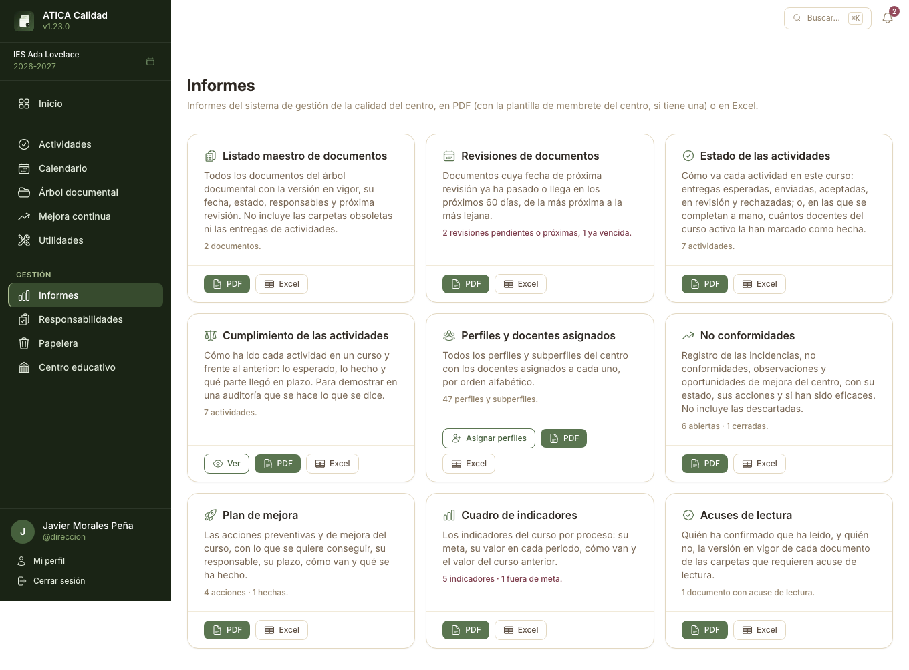
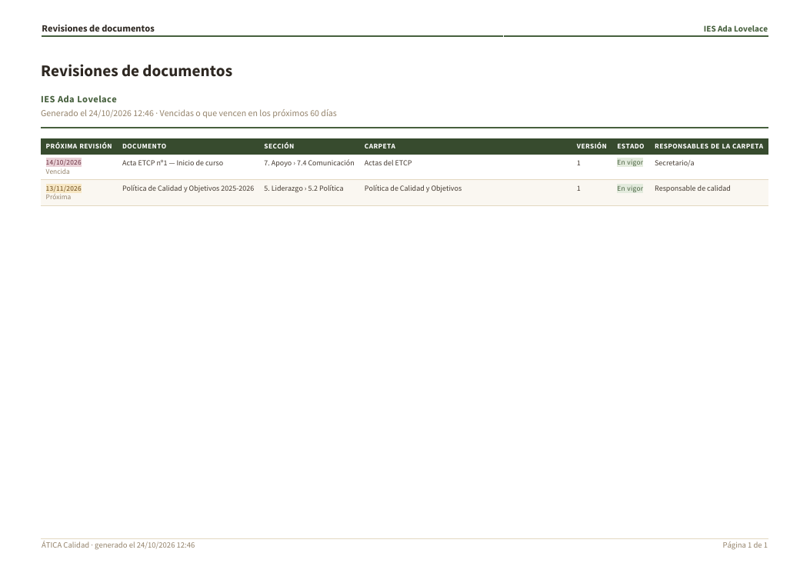
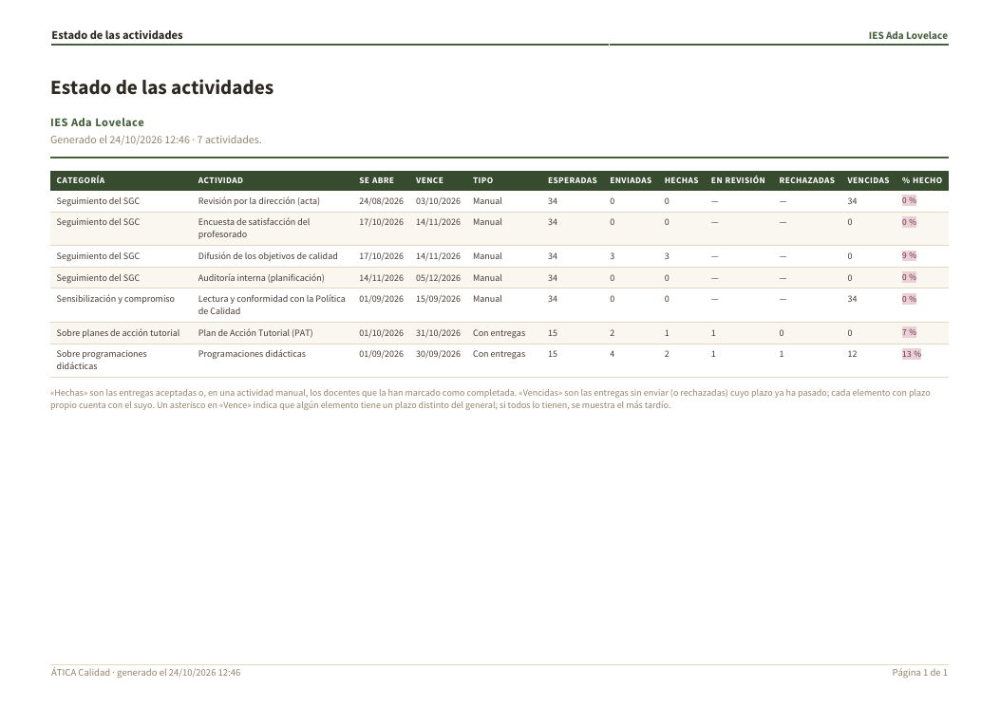
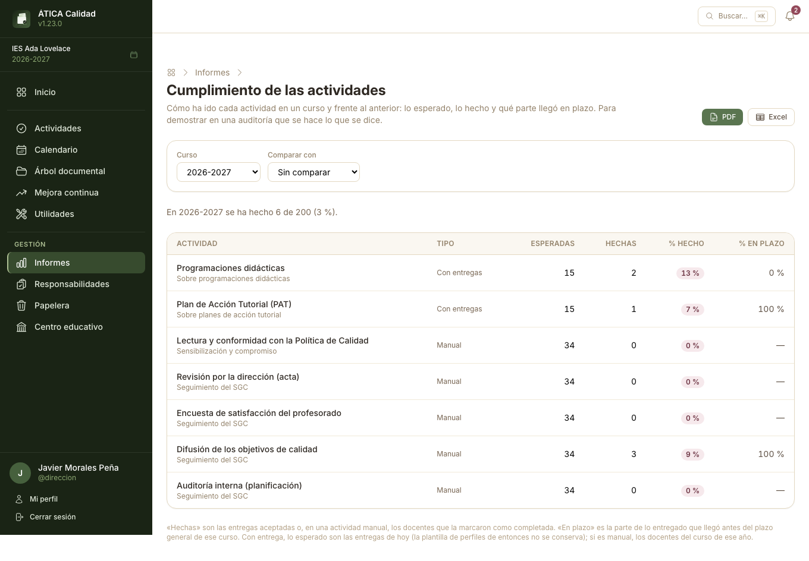
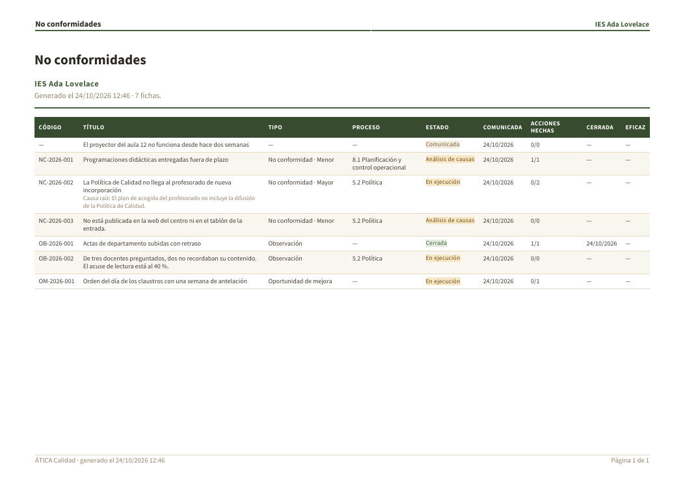
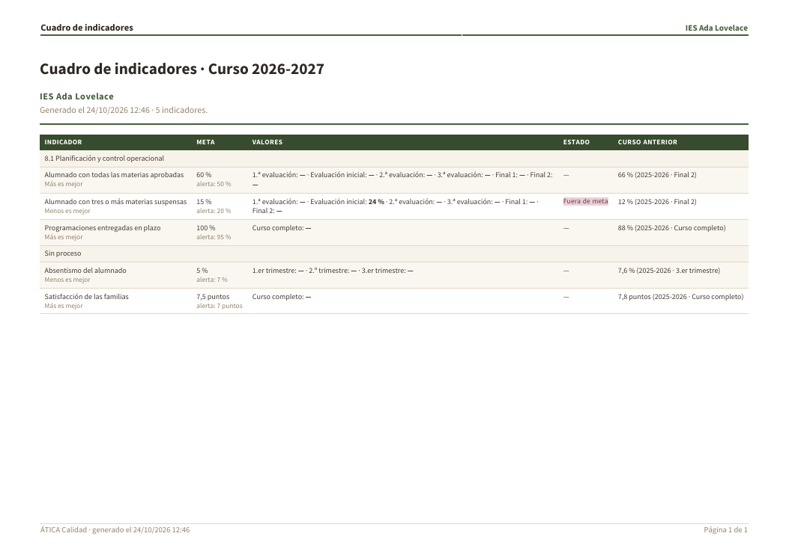
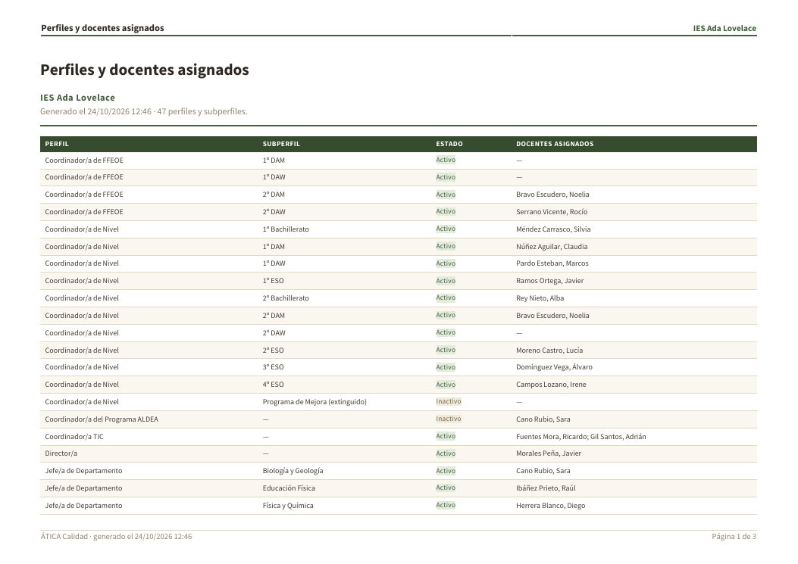

# Informes

La sección **Informes** reúne los informes del sistema de gestión de la calidad del centro. La
ven la administración y el equipo directivo del centro, el **responsable de calidad** y el
**auditor/a interno/a** (quienes ya pueden consultar todo el árbol documental).

Cada informe se descarga en **PDF** —con la plantilla de membrete del centro, si tiene una
configurada en **Ajustes del centro → Plantillas de informes**— o en **Excel**, para trabajar con
los datos. La portada de la sección resume qué contiene cada uno antes de descargarlo.

El texto gris al pie de cada tarjeta adelanta qué hay dentro: cuántos documentos entrarían en el
listado maestro, cuántas revisiones hay pendientes o próximas (y cuántas ya vencidas: el texto se
pone en rojo), cuántas actividades en su informe, cuántas fichas abiertas o cerradas hay en
Mejora continua... Cuando un informe no tiene nada que exportar (ocurre con *Revisiones de
documentos* mientras ningún documento tenga una próxima revisión vencida o cercana), sus botones
desaparecen y la tarjeta dice «No hay nada que exportar por ahora».

Las capturas de PDF de este capítulo son la primera página de cada informe, tal como se descarga:
título, centro, fecha de generación y número de filas arriba; una tabla con una fila por elemento; y
el pie con la fecha y la paginación.

## Listado maestro de documentos

En la captura, la política de calidad tiene su revisión **en ámbar** (13/11/2026, a menos de 30
días) y el acta del ETCP **en rojo** (14/10/2026, ya vencida). Los responsables de cada carpeta son
perfiles («Responsable de calidad» y «Secretario/a»), no personas concretas.

Todos los documentos del [árbol documental](07-arbol-documental.md), en el mismo orden que el árbol
(sección, carpeta y documento), con:

- la **versión en vigor** y su fecha, y quién la subió;
- su **estado**: *En vigor*, *En vigor (nueva versión en revisión)*, *Pendiente de visto bueno* o
  *Sin versión aprobada*;
- los **responsables** de la carpeta;
- la **fecha de próxima revisión**, si tiene (en rojo si ya pasó, en ámbar si llega en los próximos
  30 días).

No incluye las carpetas marcadas como obsoletas ni las carpetas de las actividades, cuyos
documentos son entregas (un registro por docente y curso), no documentos del sistema.

Es el documento que suele pedirse primero en una auditoría: qué documentos hay y qué versión de
cada uno está en vigor.

## Revisiones de documentos

Los documentos cuya **fecha de próxima revisión** ya ha pasado o llega en los próximos 60 días,
de la más próxima a la más lejana, para planificar qué hay que revisar. La fecha la pone quien
gestiona la carpeta al editar el documento (ver
[Renombrar, mover y eliminar documentos](07-arbol-documental.md#renombrar-mover-y-eliminar-documentos)).

La lista va de la revisión más próxima a la más lejana, y las ya pasadas van primero: aquí, la del
acta (**Vencida**, en rojo) antes que la de la política (**Próxima**, en ámbar). A la derecha figuran
los responsables de la carpeta, que son quienes tienen que hacer la revisión.

## Estado de las actividades

Cómo va cada [actividad](08-actividades.md) en el curso actual:

- en las que llevan **entregas**: cuántas se esperan, cuántas se han enviado, cuántas están
  aceptadas, en revisión o rechazadas;
- en las que se completan **a mano**: cuántos docentes del curso activo la han marcado como hecha.

La columna **% hecho** resume el avance (entregas aceptadas o docentes que la han completado,
sobre el total esperado).

Se distinguen a primera vista los dos tipos: «Programaciones didácticas» y «Plan de Acción Tutorial»
son **con entregas** (15 esperadas cada una); las demás son **manuales**
(34 esperadas, una por cada docente del curso). **Vencidas** son las entregas sin enviar (o
rechazadas) cuyo plazo ya pasó.

## Cumplimiento de actividades

Cómo se han cumplido las [actividades](08-actividades.md) en un curso, con posibilidad de
**compararlo con otro curso**: entregas esperadas, aceptadas y entregadas en plazo, por actividad.
Se puede ver en pantalla y descargar en **PDF** o **Excel**. Para cursos pasados, lo «esperado» es
una aproximación (las entregas de hoy si la actividad tiene carpeta, o los docentes del curso de
ese año si es manual) y «en plazo» se mide frente al plazo general de la actividad.

Arriba se elige el **curso** y, opcionalmente, **con cuál compararlo** (aquí, *Sin comparar*). La
frase de debajo resume el curso entero
(«se ha hecho 6 de 200»). Los botones **PDF** y **Excel** descargan lo que se está viendo.

## No conformidades {#no-conformidades}

El registro de [Mejora continua](09-mejora-continua.md): las no conformidades, observaciones y
oportunidades de mejora del centro, y las incidencias aún sin clasificar, con su código, tipo,
proceso, origen, estado, fecha de comunicación, cuántas acciones están hechas, fecha de cierre y
si han sido **eficaces**. En PDF incluye también la causa raíz de cada no conformidad. No incluye
las descartadas.

Es la evidencia habitual, en una auditoría, del tratamiento de las no conformidades y de la
eficacia de las acciones correctivas.

Cada tipo de ficha tiene su propio código: **NC** (no conformidad), **OB** (observación) y **OM**
(oportunidad de mejora); la ficha sin código y sin tipo es una incidencia **aún sin clasificar**.
Debajo del título de la NC-2026-002 se ve la **causa raíz** que registró el análisis, y en la
columna *Acciones hechas* cuántas de sus acciones están terminadas (0/2).

## Plan de mejora {#plan-de-mejora}

El [plan de mejora](09-mejora-continua.md#plan-de-mejora) del curso activo: cada acción preventiva o
de mejora con su código, lo que se quiere conseguir, el proceso, su responsable, el plazo, su estado
(*Vencida* si se ha pasado de plazo sin hacerse) y qué se ha hecho. Desde la página del plan se
descarga el del curso que se esté viendo, también de cursos anteriores.

## Cuadro de indicadores {#cuadro-de-indicadores}

Los [indicadores](09-mejora-continua.md#indicadores) del curso activo por proceso: la meta y el
umbral de alerta de cada uno, su valor en cada periodo, cómo va y el valor del curso anterior. En
Excel, una fila por indicador y periodo, para trabajar con los datos. Desde la página de indicadores
se descarga el del curso que se esté viendo, también de cursos anteriores.

En la captura, el único con valor registrado en este curso es el de «Alumnado con tres o más
materias suspensas» (24 % en la evaluación inicial, frente a una meta del 15 %): por eso figura
**Fuera de meta**. En el resto, los periodos aún sin dato aparecen con «—» y se compara con el
valor del curso anterior de la última columna.

## Acuses de lectura {#acuses-de-lectura}

Para cada documento de las carpetas con [acuse de lectura](07-arbol-documental.md#acuse-de-lectura),
en el orden del árbol: la versión en vigor, cuántos docentes la han leído de los que deben leerla
y **quiénes faltan**. En Excel incluye además el porcentaje leído. Sirve para demostrar en una
auditoría que la política de calidad o un protocolo se han difundido, y para saber a quién
recordárselo.

## Perfiles y docentes asignados {#perfiles-y-docentes-asignados}

Todos los [perfiles y subperfiles](06-responsabilidades.md#asignar-perfiles) del centro, por orden
alfabético (perfil y, a igualdad, subperfil), con los **docentes asignados** a cada uno por orden de
apellidos y nombre y si el perfil o subperfil está *Activo* o *Inactivo*. En Excel incluye además
cuántos docentes tiene cada uno. Sirve para demostrar en una auditoría quién desempeña cada
responsabilidad.

En la captura se ven los casos que conviene mirar en una auditoría: un subperfil **sin ningún
docente** («—», como «Coordinador/a de Nivel 2º DAW»: es una responsabilidad sin cubrir), un
subperfil **inactivo** (el de un elemento de lista retirado) y un perfil con **más de un docente**
(«Coordinador/a TIC»).

La tarjeta del informe tiene un botón **Asignar perfiles** que lleva a
[Responsabilidades → Asignar perfiles](06-responsabilidades.md#asignar-perfiles), donde se
corrigen las asignaciones (lo ven quienes pueden gestionarlas).
