# Responsabilidades

Este capítulo es para el responsable de calidad y el equipo directivo. Además de los dos perfiles
fijos del centro —**responsable de calidad** y **auditor/a interno/a**, descritos en
[Preparar el curso académico](02-preparar-el-curso-academico.md#perfiles)—, cada centro puede
necesitar responsabilidades propias: tutorías, jefaturas de familia profesional, coordinaciones...
Eso es lo que gestiona la sección **Responsabilidades**, con tres herramientas:

- **Listas** — jerarquías propias de nombres (grupos, departamentos...) que sirven de base para
  construir esas responsabilidades sin repetir trabajo.
- **Perfiles específicos** — las responsabilidades personalizadas en sí, opcionalmente construidas
  sobre una lista.
- **Asignar perfiles** — una vista de trabajo transversal sobre las asignaciones ya hechas, por
  perfil o por docente (ver [Asignar perfiles](#asignar-perfiles) más abajo).

## Acceso

**Responsabilidades** aparece en el menú lateral, entre **Centro educativo** y **Administración**,
para quien tenga alguno de estos papeles en el centro activo: **responsable de calidad**, **equipo
directivo / administración del centro** o **administración de la plataforma**. El **auditor/a
interno/a** y el resto del profesorado no la ven — a diferencia de los perfiles fijos (ver
[Permisos de un vistazo](11-permisos-de-un-vistazo.md)), esta sección sí requiere uno de esos
papeles para acceder, no solo para ser gestionada.

## Listas

Una lista es una jerarquía de nombres con la profundidad que necesites — no hay límite de niveles.
Los ejemplos de este capítulo usan los datos de demostración (el centro «IES Ada Lovelace»), que
traen cuatro listas. Tres son **planas** —sus elementos cuelgan directamente de la raíz—:

```
Grupo                 Departamento              Materia
├── 1º ESO A          ├── Matemáticas           ├── Matemáticas
├── 1º ESO B          ├── Lengua Castellana…    ├── Lengua Castellana…
├── 2º ESO A          ├── Inglés                ├── Inglés
├── …                 ├── …                     ├── …
└── 2º DAW            └── Informática           └── Fase de Formación en Empresa…
(15 grupos)           (9 departamentos)         (14 materias)
```

Y una es **anidada**, con varios niveles, y es la que mejor enseña lo que solo permite un árbol:

```
Enseñanza
├── ESO
│   ├── 1º ESO
│   ├── 2º ESO
│   ├── 3º ESO
│   ├── 4º ESO
│   └── Programa de Mejora (extinguido)      ← inactivo
├── Bachillerato
│   ├── 1º Bachillerato
│   └── 2º Bachillerato
└── Formación Profesional
    ├── DAM
    │   ├── 1º DAM
    │   └── 2º DAM
    └── DAW
        ├── 1º DAW
        └── 2º DAW
```

No hay una entidad "Lista" separada de sus elementos: cada elemento raíz (aquí, «Grupo»,
«Departamento», «Materia» y «Enseñanza») es simplemente un elemento sin padre, y toda la jerarquía
que cuelga de él se gestiona igual que el resto. Estas listas son permanentes por centro, igual que
los perfiles fijos: no se repiten cada curso académico.

!!! tip "Una lista por cada «cosa» que se repite"
    Piensa en una lista por cada eje por el que se reparten responsabilidades: los **grupos** (para
    las tutorías), los **departamentos** (para las jefaturas), las **materias** (para las
    programaciones), los **niveles** (para coordinaciones de nivel o de ciclo). No hace falta que
    todas tengan varios niveles: la mayoría son listas planas, y una estructura anidada solo se
    justifica cuando de verdad hay ramas que tratar juntas, como «ESO» o «Formación Profesional».

### Navegar y crear elementos

**Responsabilidades → Listas** muestra solo las listas del centro (los elementos raíz), cada una
con su número de elementos. Un formulario en la parte superior crea una lista nueva, las flechas
↑/↓ cambian su orden y al pulsar una se abre **su propia pantalla**, donde se gestionan sus
elementos sin que se mezclen con los de las demás listas. Los botones de exportar e importar
siguen en la pantalla de listas.

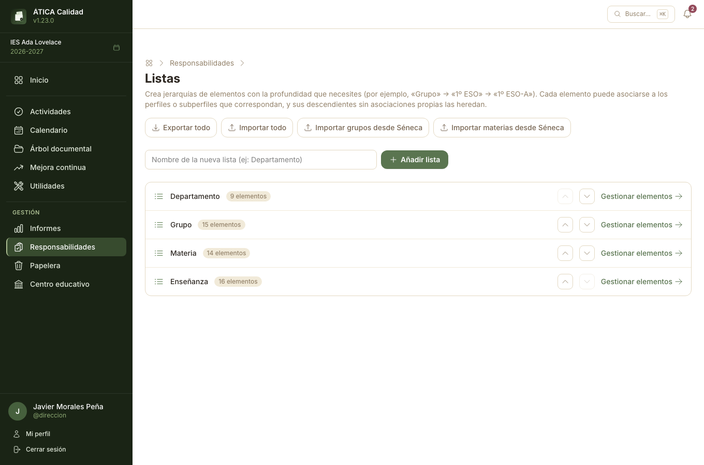

El número junto al nombre cuenta **todos** los elementos de la lista, de cualquier nivel (en
«Enseñanza», los 16: tres ramas, dos ciclos y once cursos).

En la pantalla de una lista, en pantallas grandes se muestra su árbol completo: cada elemento se
renombra, reordena o mueve a otro padre de la misma lista **arrastrándolo** (icono ⣿ a su
izquierda), igual que las secciones del árbol documental. El botón **+** junto al título añade un
elemento en el primer nivel; el que aparece al pasar por encima de un elemento añade un hijo ahí
mismo. **Editar la lista** abre el panel de edición de la propia raíz (nombre, estado,
asociaciones, eliminarla). Un icono de enlace violeta junto al nombre indica que ese elemento ya
tiene un perfil o subperfil asociado (ver
[Asociar un elemento con un perfil](#asociar-un-elemento-con-un-perfil) más abajo).

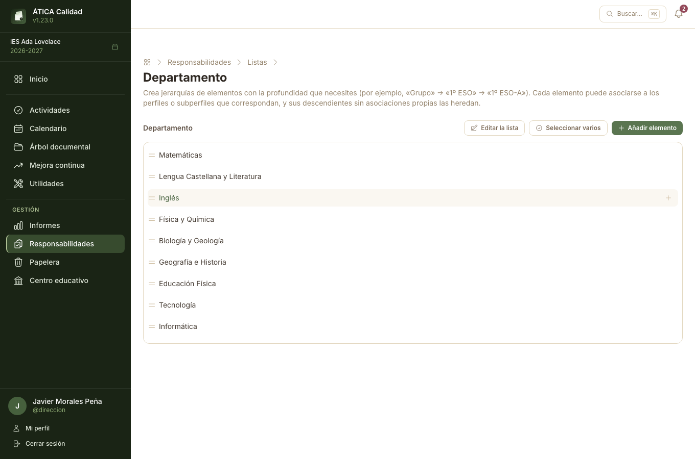

En una lista **anidada** el árbol muestra todos los niveles a la vez. En «Enseñanza» se ven, de un
vistazo, las tres ramas con sus elementos; el **ojo tachado** de «Programa de Mejora (extinguido)»
marca un elemento [inactivo](#elementos-activos-e-inactivos); y los iconos de **enlace** de la rama
«Formación Profesional» —uno intenso en la rama y otro **atenuado** en cada elemento que cuelga de
ella— son las [asociaciones](#asociar-un-elemento-con-un-perfil): la rama tiene una propia y sus
descendientes la heredan, salvo «2º DAW», que tiene la suya.

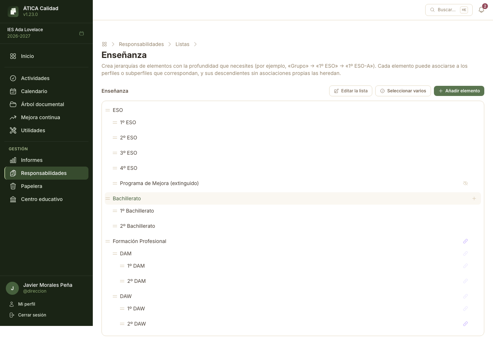

En pantallas pequeñas se navega con migas de pan en su lugar: empiezas en el primer nivel de la
lista y tocas el icono de flecha de un elemento para entrar en sus hijos, sin arrastrar — se
reordena con las flechas ↑/↓ del panel de edición. Un formulario en la parte inferior de cada
nivel añade elementos nuevos ahí mismo. El botón de ordenar (icono de flechas) reordena
alfabéticamente todos los elementos del nivel actual de una vez.

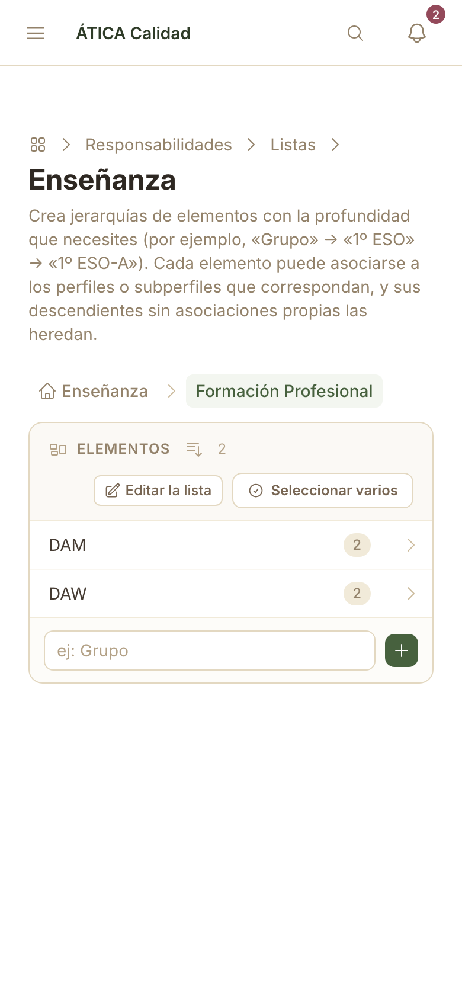

Las migas de pan de arriba (**Enseñanza › Formación Profesional**) dicen dónde estás; tocar
**Enseñanza** vuelve al primer nivel. El número de cada fila es la cantidad de hijos que tiene.

En ambos tamaños, tocar el nombre de un elemento abre el mismo panel de edición debajo (nombre,
estado, asociaciones a perfiles) — arrastrar nunca abre el panel, solo reordena o mueve.

### Mover elementos a otra lista

Arrastrar solo mueve dentro de la lista que estás gestionando. Para llevar elementos a **otra
lista**, pulsa **Seleccionar varios**, marca los elementos (cada uno se lleva consigo todos sus
hijos), elige el destino en el desplegable **Mover dentro de…** — que ofrece los elementos de todas
las listas del centro — y pulsa **Mover**. Los elementos desaparecen de la pantalla actual y
aparecen en el destino. La opción **Nueva lista independiente** convierte los elementos marcados
en listas propias.

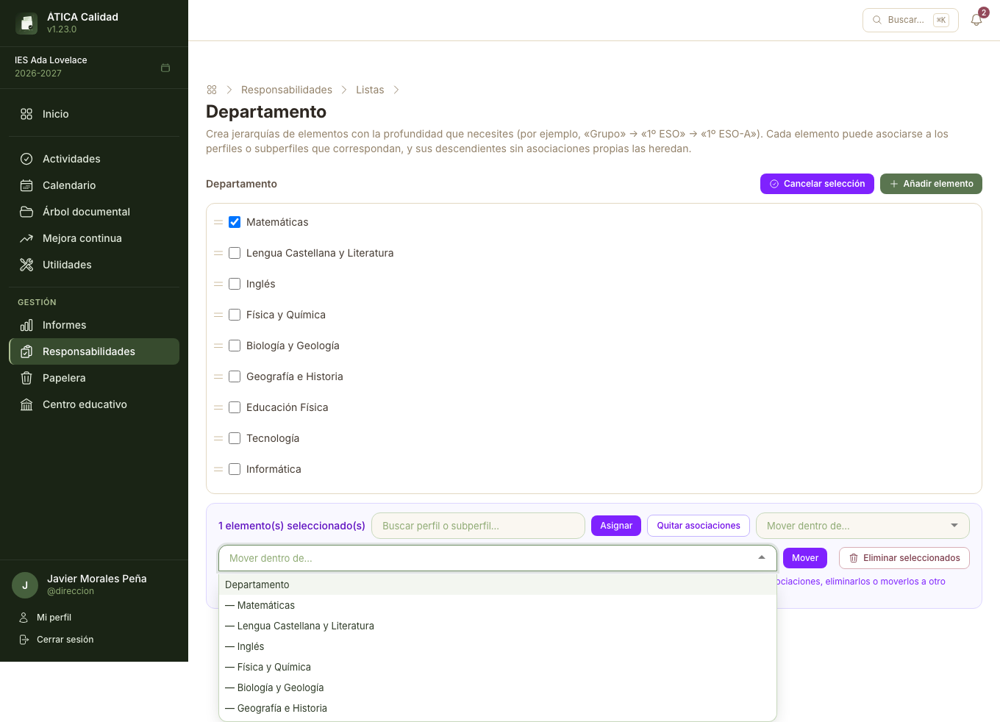

!!! warning "Mover no modifica las asignaciones, pero sí lo que heredan"
    Los docentes asignados a un elemento siguen asignados tras moverlo, y los perfiles asociados
    a él también. Pero un elemento sin asociaciones propias hereda las del padre más cercano que
    las tenga: al cambiar de lista puede heredar otras distintas, y un perfil asociado a una rama
    pierde los elementos que saques de ella. Lo mismo ocurre con los subperfiles: si un perfil
    deriva sus subperfiles de un elemento, los hijos que muevas fuera dejan de ser subperfiles
    suyos (y entran como subperfiles del perfil asociado al destino, si lo hay). Revisa las
    asociaciones y las asignaciones después de mover. Cuando el movimiento cambia los perfiles que
    se aplican a algún elemento, se pide confirmación antes de hacerlo.

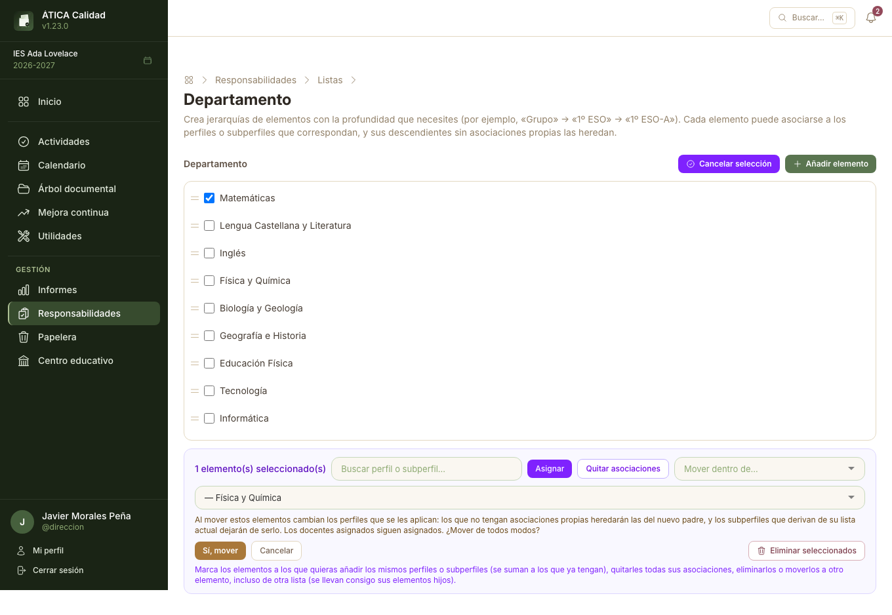

### Asociar un elemento con un perfil

Cada elemento puede vincularse, opcionalmente, a un perfil o subperfil de Responsabilidades — por
ejemplo, una materia con la jefatura de departamento de la que depende. Es una referencia suelta,
sin relación con la jerarquía de la lista, distinta de [asociar un perfil a una lista para generar
subperfiles](#asociar-un-perfil-a-una-lista-subperfiles): esta usa
[Actividades](08-actividades.md#campos-de-una-actividad) para decidir a qué perfil corresponde la
entrega nombrada por cada hoja de una lista.

Un elemento puede tener **varios** perfiles o subperfiles asociados. En los datos de demostración,
la materia «Tecnología» la imparten dos departamentos, así que está asociada a **dos** subperfiles:
«Jefe/a de Departamento Tecnología» y «Jefe/a de Departamento Informática». Una actividad que reparta
una entrega por materia le pedirá entonces su programación a las dos jefaturas, cada una la suya.

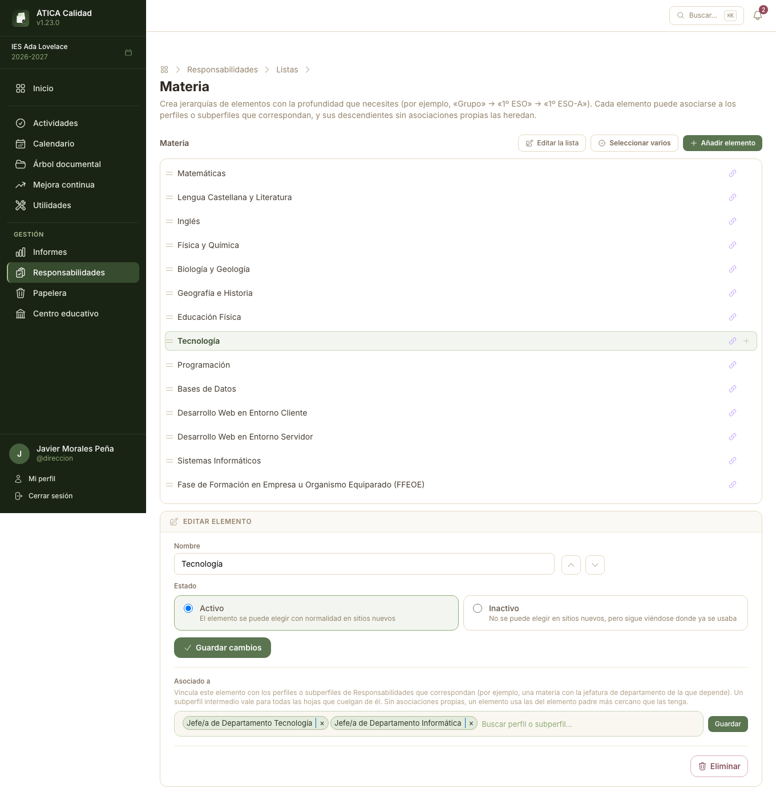

Con un perfil asociado a una lista se puede elegir una hoja concreta (p. ej. «Coordinador/a de Nivel
2º DAW») o un **elemento intermedio** (p. ej. «Coordinador/a de Nivel Formación Profesional
(todos)»), que equivale a elegir una a una todas las hojas que cuelgan de él: la actividad pedirá una
entrega por cada una de ellas. No se ofrece el perfil entero: un elemento asociado a un perfil con
lista indica siempre en qué punto de ella.

Un elemento **sin asociaciones propias hereda las del elemento padre más cercano que las tenga**:
basta con asociar la rama para que lo apliquen todas sus hojas. En la lista «Enseñanza», la rama
«Formación Profesional» está asociada al subperfil «Jefe/a de Departamento Informática», y «1º DAW»
—que cuelga de ella, dentro de «DAW»— no tiene nada propio: el panel del elemento lo dice, y el
enlace atenuado del árbol lo marca.

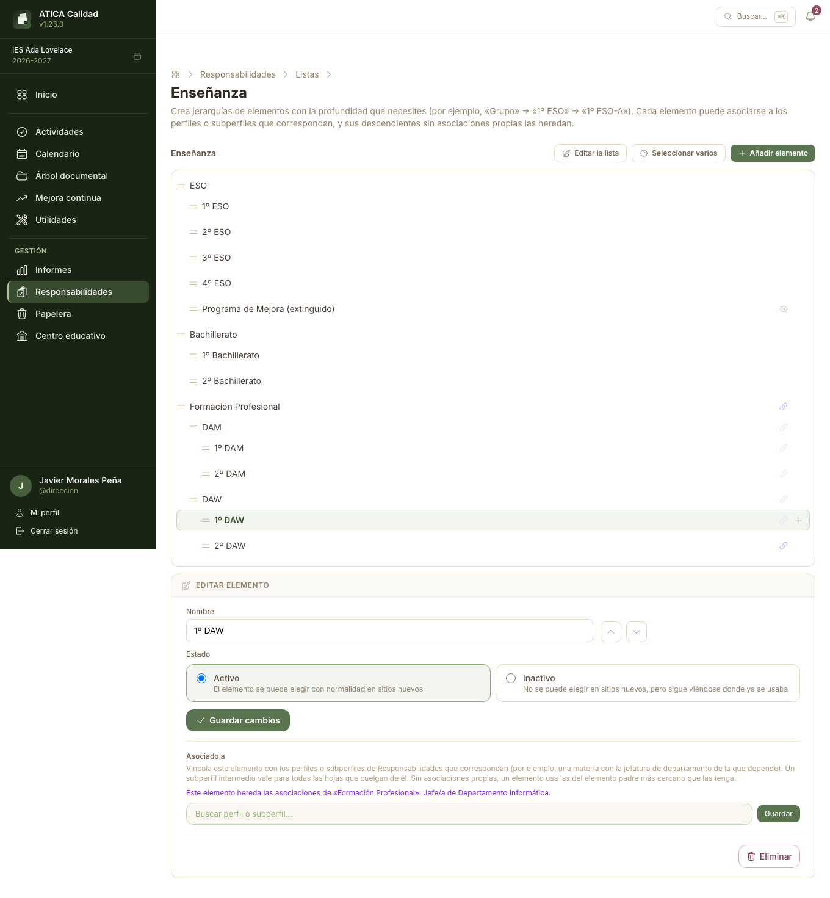

Si el elemento tiene asociaciones propias, usa **solo esas**: no se suman a las del padre. «2º DAW»
también cuelga de «Formación Profesional», pero tiene la suya —«Tutor/a 2º DAW»—, así que ya no
hereda «Jefe/a de Departamento Informática» y el panel ya no muestra el aviso de herencia.

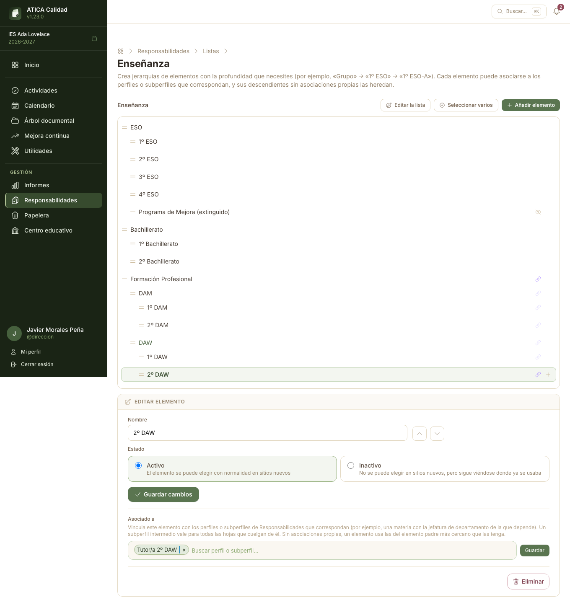

Para un elemento a la vez, se hace desde su panel de edición (**Asociado a**, con el mismo
buscador de perfil/subperfil que en el resto de la aplicación, en el que se pueden elegir varios).
Guardar deja al elemento con exactamente los elegidos. Para varios elementos a la vez, **Seleccionar
varios** —junto al título en pantallas grandes, o junto al contador de elementos en pequeñas—
sustituye el botón de cada elemento por una casilla; con uno o más marcados aparece una barra con
el mismo buscador y dos botones: **Asignar** **añade** los perfiles elegidos a los que ya tenga cada
elemento marcado, y **Quitar asociaciones** se las quita todas. La selección no se limita a los
hijos de un mismo elemento: se puede marcar en varias ramas distintas antes de asignar.

### Elementos activos e inactivos

Cada elemento tiene un estado, **activo** o **inactivo**. Los elementos inactivos dejan de poder
elegirse en sitios nuevos (por ejemplo, al asociar un perfil específico a un elemento de la lista),
pero siguen viéndose con normalidad donde ya se estuvieran usando — no desaparece nada de golpe.
Útil, por ejemplo, para retirar un grupo del curso anterior sin perder su histórico. En
«Enseñanza», «Programa de Mejora (extinguido)» es un ejemplo: ya no se imparte, así que está
inactivo (el ojo tachado del árbol), y su subperfil «Coordinador/a de Nivel Programa de Mejora
(extinguido)» figura como inactivo en [Asignar perfiles](#asignar-perfiles) y en el informe de
[perfiles y docentes asignados](04-informes.md#perfiles-y-docentes-asignados).

### Eliminar elementos

Eliminar un elemento **elimina también todos sus hijos**: una rama entera se borra de una vez
(pide confirmación, y avisa si tiene hijos). Es el caso de quitar «ESO» con sus cinco cursos.

Lo que lo impide es que algo **esté en uso**: si el elemento, o cualquiera de sus descendientes,
está asociado a un perfil específico, o hay docentes asignados a través de él (ver
[Perfiles específicos](#perfiles-especificos) más abajo), no se elimina nada —ni siquiera los hijos
que sí se podrían—, y se explica por qué. En ese caso, lo adecuado es
[desactivarlo](#elementos-activos-e-inactivos), no eliminarlo.

### Importar desde Séneca

Dos botones en la parte superior de Listas — **Importar grupos desde Séneca** e **Importar
materias desde Séneca** — construyen una lista automáticamente a partir de los ficheros CSV que
exporta Séneca, en vez de crear cada elemento a mano:

- **Grupos**: en Séneca, con perfil Dirección, ve a **Alumnado → Relación de unidades → Curso:
  Cualquiera → Exportar datos**. Cada unidad del fichero se añade como un elemento dentro de la
  raíz elegida.
- **Materias**: en Séneca, con perfil Dirección, ve a **Personal → Personal del centro → Materias
  y grupos → Unidad: Cualquiera → Exportar datos**. Cada grupo del fichero se añade dentro de la
  raíz, y cada materia de ese grupo se añade dentro de su grupo.

Al elegir el fichero se pide también el **nombre de la raíz** que va a contener lo importado —
propone «Grupo» o «Materia» según el tipo, pero se puede escribir otro nombre; si ya existe una
raíz con ese nombre (comparando sin distinguir mayúsculas), se actualiza en vez de crear una nueva.

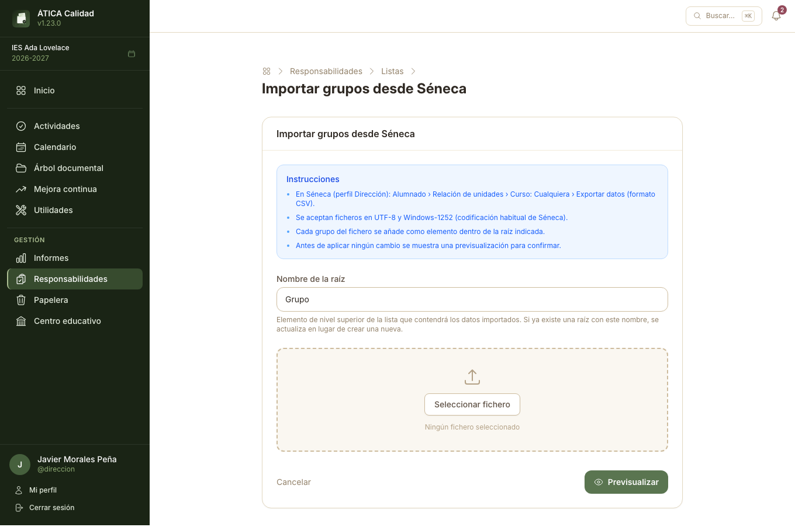

Antes de tocar nada se muestra una **previsualización**: qué elementos se añadirían, cuáles ya
existen y se reactivarían (si estaban inactivos) y cuáles ya no aparecen en el fichero. Para estos
últimos hay que elegir qué hacer:

- **Eliminar** los que no estén en uso.
- **Desactivar** en vez de eliminar — los que sí estén en uso (asociados a un perfil específico,
  con docentes asignados a través de uno, o usados en algún documento entregado) siempre se
  desactivan, nunca se eliminan, aunque se elija «Eliminar»; un elemento con hijos solo se puede
  eliminar si todos sus hijos también se pueden eliminar.

Nada se aplica hasta confirmar la previsualización.

La captura es la previsualización de un fichero de grupos de ejemplo contra la lista «Grupo» ya
existente (de ahí «Se actualizará la raíz existente «Grupo»»). Muestra los cuatro casos:

- **Se añadirán (2)**: «1º ESO C» y «3º ESO C» están en el fichero y no en la lista.
- **Se reactivarán (1)**: «4º ESO A» está en el fichero y en la lista, pero estaba inactivo.
- **Se eliminarán (1)**: «2º PMAR» ya no está en el fichero y **no está en uso** —ningún perfil ni
  asignación depende de él—, así que se borra.
- **Se desactivarán (2)**: «1º Bach. B (Humanidades)» y «2º Bach. B» tampoco están en el fichero,
  pero **sí están en uso** (tienen tutor asignado): no se pueden borrar sin dejar huérfana esa
  asignación, así que se desactivan.

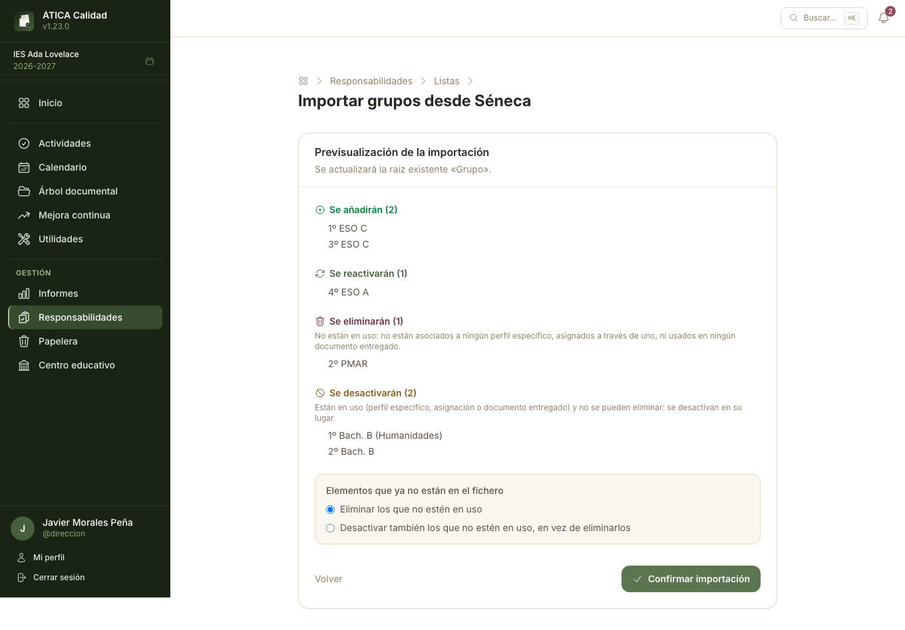

Debajo, el cuadro **Elementos que ya no están en el fichero** deja elegir entre *Eliminar los que no
estén en uso* (la opción por defecto, lo que muestra la captura) y *Desactivar también los que no
estén en uso, en vez de eliminarlos*.

La importación de **materias** construye un árbol de dos niveles: cada grupo del fichero con sus
materias dentro. Aquí, con un nombre de raíz que no existe todavía («Materias por grupo»), todo
aparece como «Se añadirán» y se ve la estructura que se crearía:

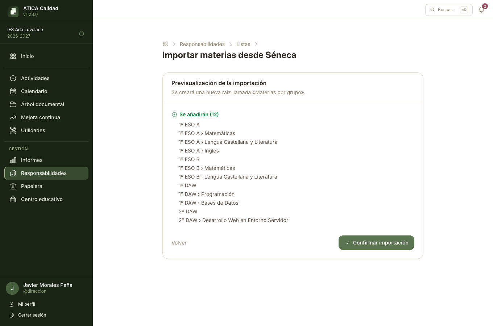

## Perfiles específicos

Un perfil específico es una responsabilidad personalizada del centro — a diferencia de los perfiles
fijos (responsable de calidad, auditor/a interno/a), cada centro define los suyos con el nombre que
necesite: «Tutor/a», «Jefe/a de Departamento», «Coordinador/a TIC»...

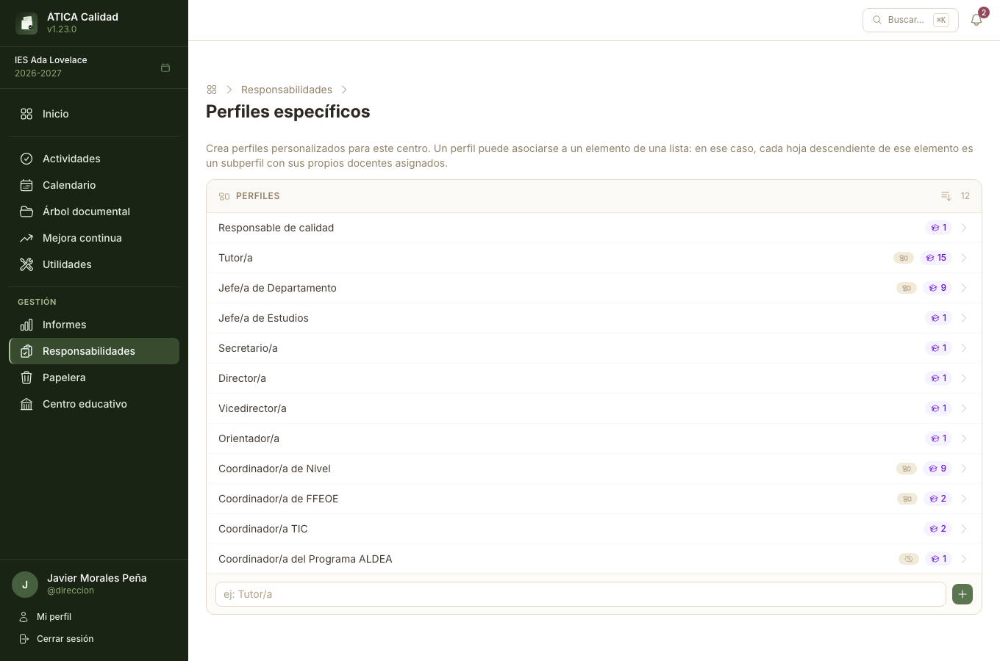

La lista muestra, a la derecha de cada perfil, tres pistas: el **icono de lista** si está
asociado a una (como «Tutor/a», «Jefe/a de Departamento», «Coordinador/a de Nivel» y «Coordinador/a de
FFEOE»), el **ojo tachado** si está inactivo («Coordinador/a del Programa ALDEA») y el **número de
docentes** asignados. Pulsar un perfil abre su panel de edición debajo.

### Asignación directa

En su forma más simple, un perfil específico no está asociado a ninguna lista: se crea con un
nombre y se le asignan directamente uno o varios docentes, buscándolos por nombre en el propio panel
de detalle. Es el caso adecuado para responsabilidades que no se repiten por grupo, departamento ni
ningún otro criterio — por ejemplo, «Coordinador/a TIC».

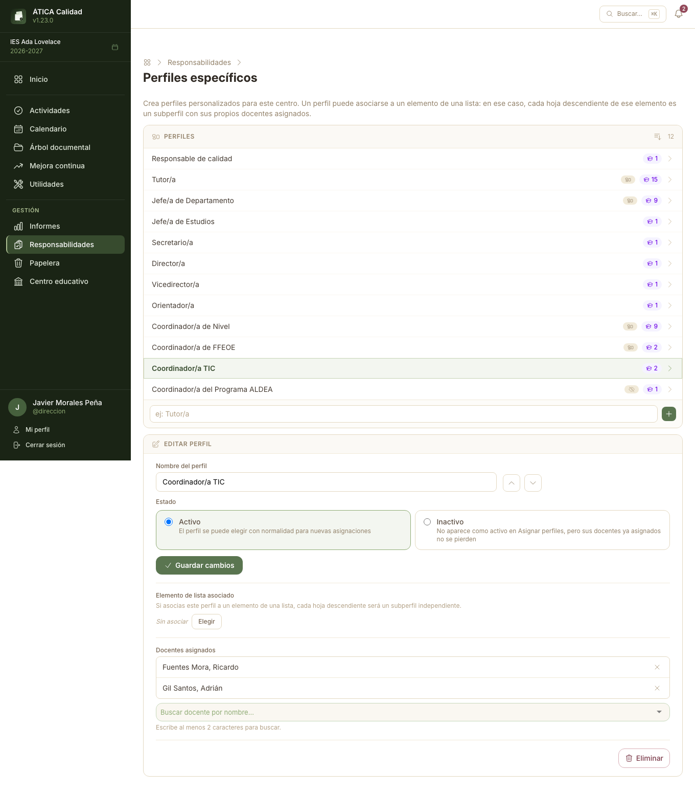

En el panel, **Elemento de lista asociado** dice «Sin asociar», y **Docentes asignados** lista a quien
ya tiene el perfil (aquí, dos: «Fuentes Mora, Ricardo» y «Gil Santos, Adrián»), cada uno con una cruz
para quitarlo. El campo de abajo busca docentes por nombre (a partir de dos letras) para añadir más.
El perfil también se puede renombrar, desactivar o eliminar desde este panel. (Ricardo Fuentes ya no
está en el curso activo: en [Asignar perfiles](#asignar-perfiles) aparece resaltado en rojo.)

### Asociar un perfil a una lista: subperfiles

Cuando la responsabilidad sí se repite una vez por cada elemento de una lista, en vez de crear un
perfil por elemento a mano, asocias el perfil **a un elemento de una lista** (sección **Elemento de
lista asociado** → **Elegir**, con el mismo navegador de migas de pan que en Listas; una vez
elegido, el mismo sitio ofrece **Cambiar** y **Quitar asociación**). A partir de ahí, cada elemento
**hoja** (sin hijos) descendiente de ese elemento se convierte automáticamente en un **subperfil**
independiente, con sus propios docentes asignados — no hace falta crearlos ni mantenerlos a mano, se
derivan solos de la lista.

El nombre de cada subperfil es el del perfil seguido del nombre de la hoja. Dos ejemplos de los
datos de demostración:

- Perfil **«Coordinador/a de Nivel»** asociado a la raíz **«Enseñanza»** → aparecen los subperfiles
  **«Coordinador/a de Nivel 1º ESO»**, **«… 2º ESO»**, **«… 1º Bachillerato»**, **«… 1º DAM»**, etc. —
  uno por cada curso, 11 en total, pase lo que pase con las ramas intermedias («ESO», «DAM»...), que
  no generan subperfil propio porque no son hojas.
- Perfil **«Coordinador/a de FFEOE»** asociado al elemento **«Formación Profesional»** (que cuelga
  de «Enseñanza») → aparecen solo los cuatro subperfiles **«Coordinador/a de FFEOE 1º DAM»**,
  **«… 2º DAM»**, **«… 1º DAW»** y **«… 2º DAW»** — los de esa rama, sin los de «ESO» ni
  «Bachillerato».

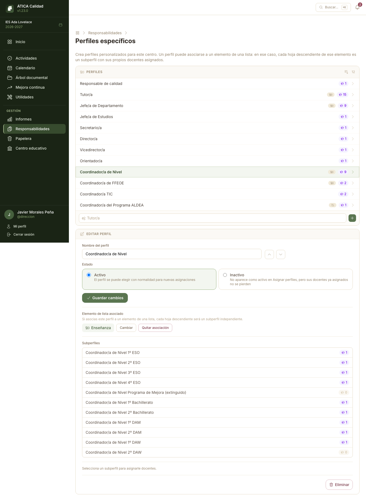

En la lista de **Subperfiles** del panel, la cifra de la derecha es el número de docentes de cada
uno. Los dos que tienen **0** (en gris) son «2º DAW», que simplemente aún no tiene coordinador/a, y
«Programa de Mejora (extinguido)», cuyo elemento de lista está inactivo.

Nótese que el elemento asociado no tiene por qué ser una raíz: en el segundo ejemplo, el perfil se
asocia a «Formación Profesional», un hijo de «Enseñanza», así que solo genera subperfiles a partir de
sus propias hojas, ignorando las demás ramas.

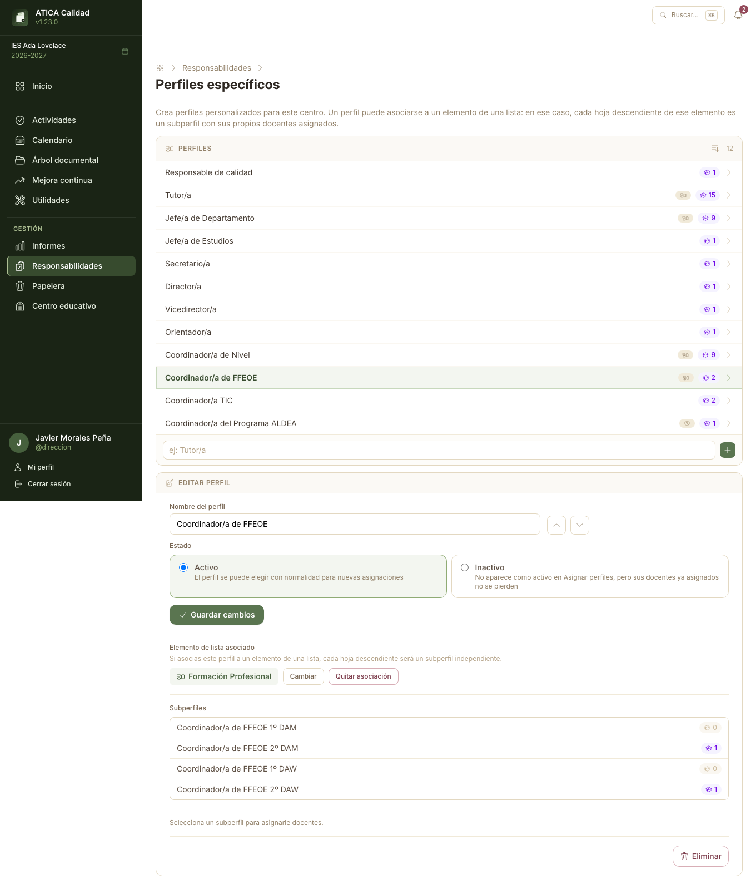

Para asignar docentes, selecciona primero el subperfil que corresponda en la lista de la sección
**Subperfiles** y después búscalos por nombre, igual que en la asignación directa. Al pulsar
«Coordinador/a de Nivel 2º DAW», el panel pasa a decir «Docentes asignados — Coordinador/a de Nivel
2º DAW» y «Todavía no hay docentes asignados», con el buscador para añadir uno.

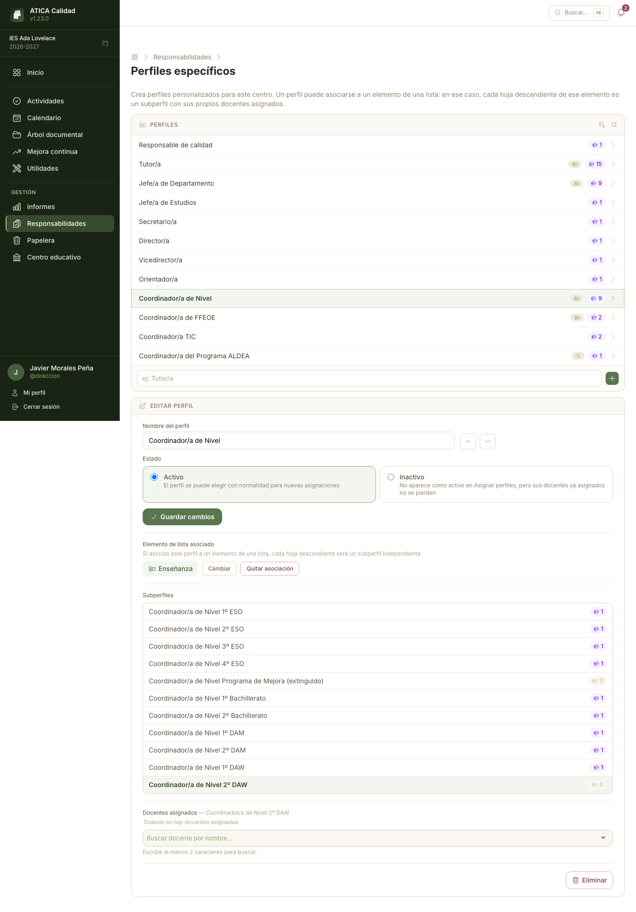

#### Elegir un perfil con subperfiles en un permiso {#elegir-subperfiles-en-un-permiso}

Los docentes se asignan siempre a hojas, pero al **elegir perfiles** para los permisos de una carpeta
o de una sección, para una actividad o para un evento del calendario hay tres niveles de precisión.
Tomando el ejemplo de «Coordinador/a de Nivel» asociado a «Enseñanza»:

- **«Coordinador/a de Nivel (todos)»**: cualquiera que tenga alguna hoja del perfil.
- **«Coordinador/a de Nivel Formación Profesional (todos)»**: un elemento intermedio. Vale para todas
  las hojas que cuelgan de él: quien coordine 1º o 2º de DAM o de DAW, pero no quien coordine 3º de ESO.
  Hay uno por cada rama («ESO», «Bachillerato», «Formación Profesional») y por cada ciclo («DAM»,
  «DAW»).
- **«Coordinador/a de Nivel 2º DAW»**: una hoja concreta.

El buscador del selector filtra también los elementos intermedios por su nombre. La captura es el
selector de un evento del calendario restringido a perfiles, tras escribir «Nivel (todos)»: aparecen
primero el perfil entero, y después una opción por cada elemento intermedio.

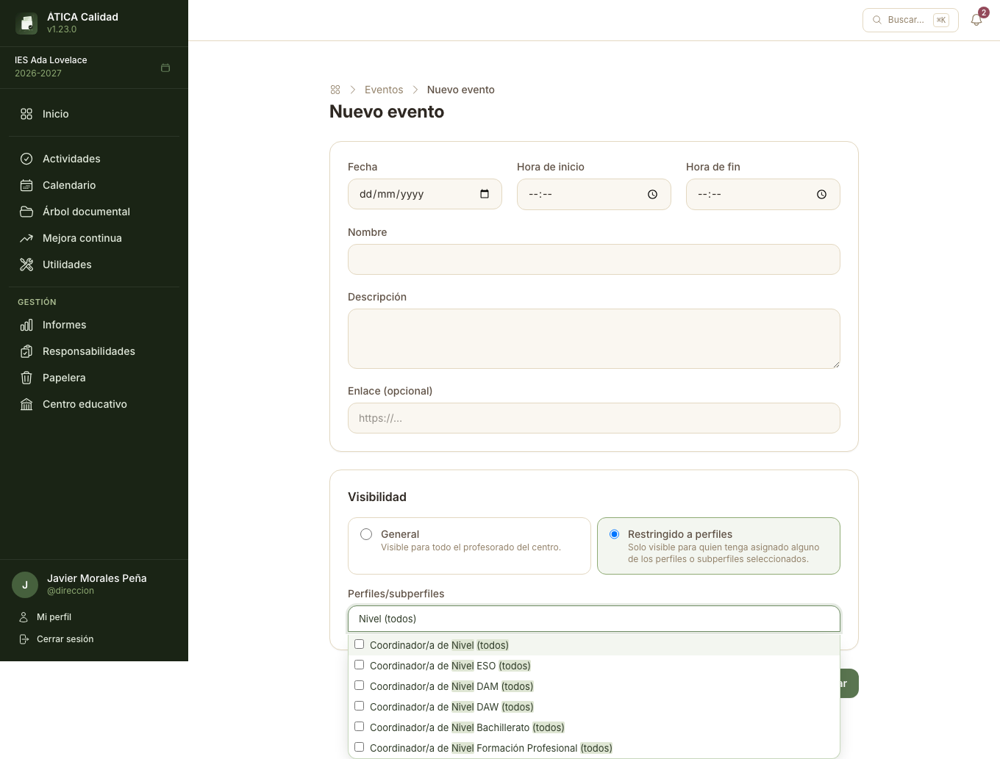

!!! warning "Cambiar o quitar la asociación borra las asignaciones existentes"
    Si cambias el elemento de lista asociado a un perfil, o quitas la asociación (**Quitar
    asociación**), se eliminan **todas** las asignaciones de docentes de ese perfil — tanto las
    directas como las de todos sus subperfiles. Tiene sentido: las asignaciones existentes estaban
    ligadas a los subperfiles derivados de la asociación anterior, y ya no significan lo mismo con
    la nueva. Antes de cambiar la asociación de un perfil que ya tiene docentes asignados, anota
    quién estaba en cada subperfil si vas a necesitar volver a asignarlos.

### Perfiles activos e inactivos

Igual que los elementos de lista, un perfil específico tiene un estado, **activo** o **inactivo**.
Un perfil inactivo (y, si está asociado a una lista, cada uno de sus subperfiles) deja de poder
elegirse para asignaciones nuevas — tanto al asignar un docente directamente como al restringir un
evento del calendario (ver [Asignar perfiles](#asignar-perfiles) y
[Calendario](03-calendario.md#eventos)) — pero los docentes ya asignados no se pierden.

### Ordenar y eliminar perfiles

El botón de ordenar alfabético (junto al listado de perfiles) reordena todos los perfiles
específicos del centro de una vez. Eliminar un perfil elimina también todas sus asignaciones de
docentes, directas o a través de subperfiles; como los perfiles específicos ya no tienen jerarquía
propia, no hace falta comprobar hijos antes de borrar.

## Asignar perfiles

Mientras que **Perfiles específicos** es donde se crean y configuran los perfiles, **Asignar
perfiles** es una vista de trabajo sobre las asignaciones que ya existen, pensada para comprobar de
un vistazo quién tiene qué — especialmente útil al empezar un curso nuevo, cuando algunos docentes
ya no están. Tiene dos pestañas:

- **Perfiles** — todos los perfiles y subperfiles activos del centro, con los docentes asignados a
  cada uno. Un docente que ya no pertenece al curso académico activo se resalta en rojo. Un botón
  permite quitar de golpe, de todos los perfiles activos, a los docentes que ya no pertenecen al
  curso activo (con confirmación previa). Un botón aparte muestra también los perfiles/subperfiles
  inactivos, aparte del filtro por defecto. Al tocar un perfil se abre un panel para añadir o quitar
  docentes.
- **Docentes** — todos los docentes del curso académico activo (un botón permite ver también los de
  otros cursos, si todavía tienen alguna asignación), con los perfiles que tiene cada uno. Un perfil
  o subperfil inactivo se marca en rojo. Al tocar un docente se abre un panel para añadir o quitar
  perfiles. Para dar el mismo perfil o subperfil a varios docentes a la vez, marca sus casillas (o
  usa **Marcar todos los docentes del filtro**, que marca a todos los que coinciden con la búsqueda,
  también en otras páginas), elige el perfil en el panel que aparece y pulsa **Asignar a los
  marcados**. A quien ya lo tenía no se le repite, y la selección se vacía al terminar.

Ambas pestañas incluyen buscador (por nombre de perfil/subperfil o de docente) y paginación.


En la captura, la primera fila ya enseña el aviso más útil: **«Fuentes Mora, Ricardo»**, en rojo y
con un triángulo, es un docente que **ya no pertenece al curso activo** pero sigue asignado a
«Coordinador/a TIC». Debajo hay subperfiles con *«Sin docentes asignados»* (una responsabilidad sin
cubrir). El botón **Quitar docentes fuera de curso** lleva un contador —aquí, 1— con las personas a
las que afectaría. En total hay 45 perfiles y subperfiles activos en tres páginas.

Los perfiles y subperfiles **inactivos** no salen por defecto. **Mostrar inactivos** los incorpora a
la lista, atenuados y con la marca *(Perfil inactivo.)*; en la captura se ha buscado «ALDEA» para
ver uno:

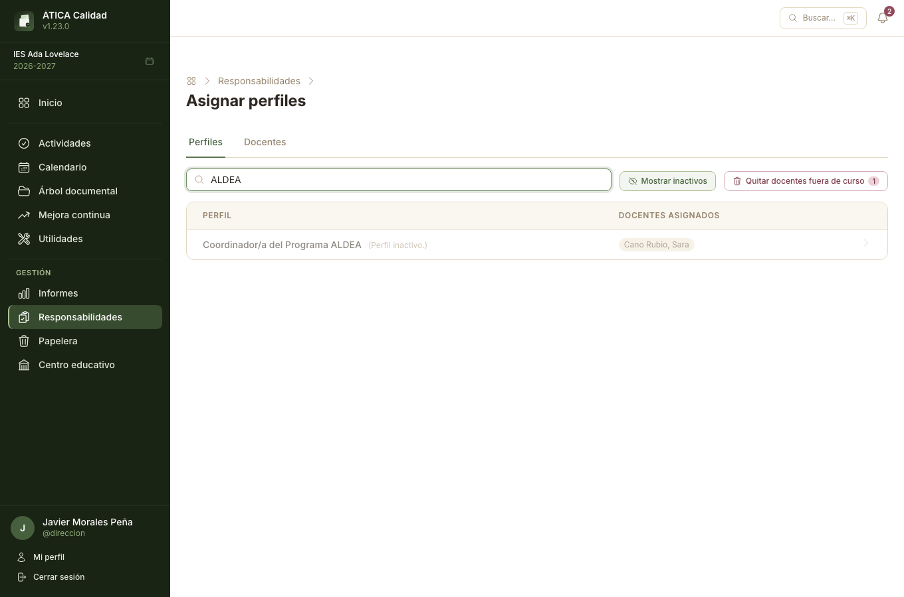

Un perfil inactivo conserva a los docentes que ya tenía (aquí, «Cano Rubio, Sara»), pero no se
ofrece para asignaciones nuevas.

La pestaña **Docentes** da la vuelta a la vista: una fila por docente, con todos sus perfiles. Aquí
se ha buscado «Bravo» y se ha abierto el panel de la primera coincidencia:


Una misma docente puede reunir varios cargos a la vez: «Bravo Escudero, Noelia» coordina el nivel
2º DAM, la FFEOE de 2º DAM y es tutora de 2º DAM. El panel de debajo lista sus perfiles (cada uno con
una cruz para quitarlo) y un buscador con un botón **Añadir** por cada perfil o subperfil disponible.
