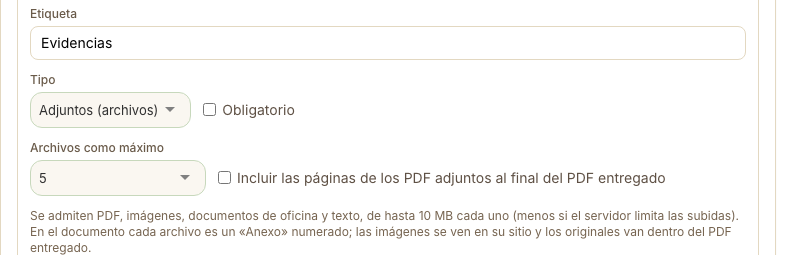
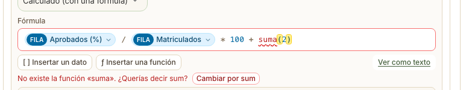
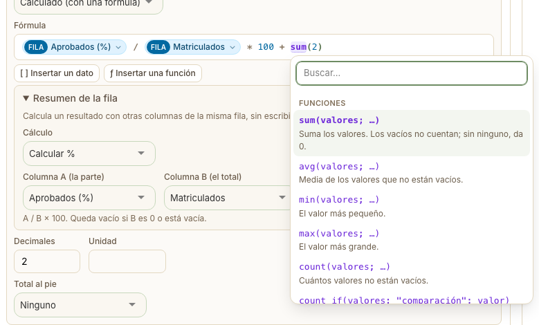
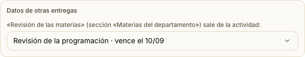
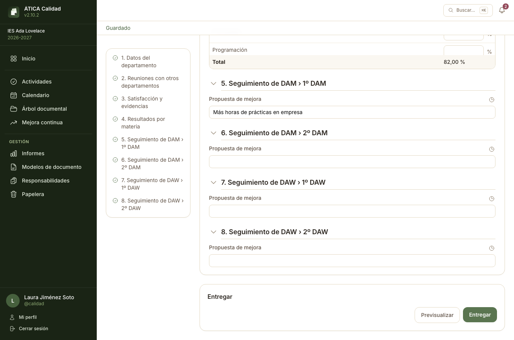
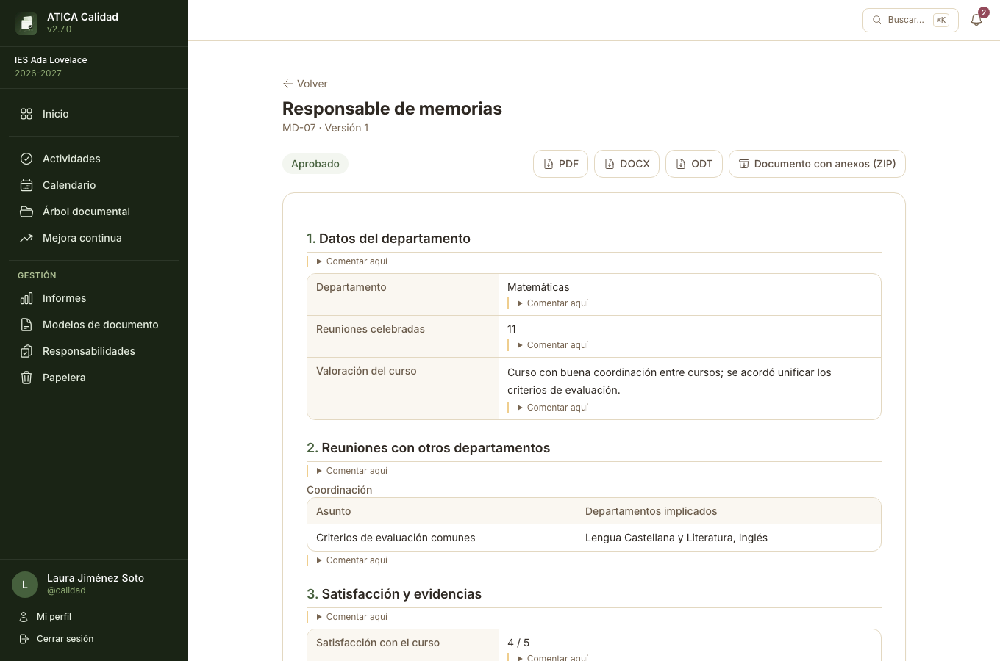
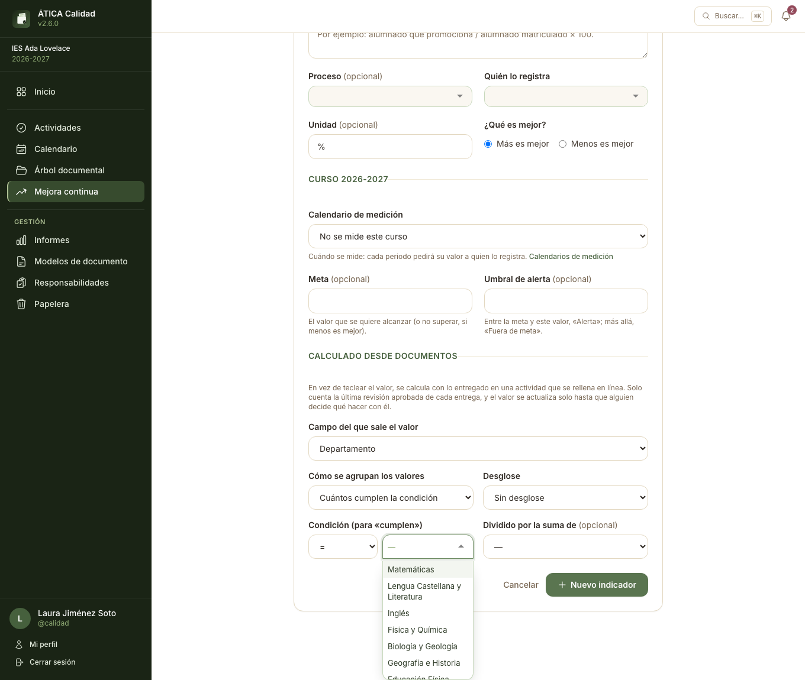

# Modelos de documento

Un **modelo de documento** es un documento con estructura —secciones, textos, campos y tablas— que se
**rellena en línea** en vez de descargarlo, completarlo en un procesador de textos y volver a subirlo.
Sirve para las fichas, actas, memorias y formularios que el centro repite cada curso: quien lo rellena
ve el mismo documento que verá quien lo revise, con los totales calculados, los datos del curso
anterior ya puestos y la entrega guardada como PDF en el árbol documental.

Quien gestiona la calidad (responsable de calidad, equipo directivo o administración del centro)
define los modelos en **Gestión → Modelos de documento**; el resto del profesorado solo los rellena.

> Este capítulo no lleva capturas de pantalla todavía: se añadirán con el resto del manual en cuanto
> se regeneren con los datos de demostración.

## Cómo encaja con lo demás

- Un modelo **es un documento del árbol documental**: vive en una carpeta, tiene versiones
  («revisiones») y pasa por la revisión de esa carpeta como cualquier documento. Su PDF en blanco es lo
  que ve quien lo busca en el árbol.
- Un documento rellenado **no se crea suelto**: nace como la **entrega de una actividad** que, en
  lugar de «Subiendo un fichero», se entrega **rellenando un modelo** (campo *Cómo se entrega* de la
  actividad). Se guarda en la carpeta de la actividad como un PDF y pasa por su revisión.
- Cada documento rellenado recuerda **con qué revisión del modelo** se hizo: si el modelo cambia
  después, lo ya entregado se sigue viendo tal como se entregó.

## Crear y editar un modelo

En **Modelos de documento** pulsa **Nuevo modelo**; en la ventana que se abre escribe el nombre, el código
que irá en la cabecera del PDF (por ejemplo `MD850703`) y la carpeta (el desplegable permite buscarla
escribiendo), y pulsa **Crear y editar**. El editor guarda el borrador solo mientras
escribes; si otra persona o pestaña guarda a la vez, te avisa en vez de pisar sus cambios.

El editor se organiza en **pestañas**: *Contenido* (con el índice a la izquierda), *Reglas de coherencia*,
*Pasos de aprobación* e *Indicadores* (esta última solo si el modelo tiene campos que ofrecer). Cada pestaña
muestra su estado: un **punto ámbar** si esa parte difiere de la última revisión enviada y un **número
rojo** con los problemas que impiden enviarla. Encima de las pestañas, una **barra fija** dice si hay
cambios sin enviar y tiene el botón de envío.

Cada fila enlaza con lo relacionado: la ruta **sección › carpeta** abre el modelo en su carpeta del
árbol documental, y debajo aparecen las **actividades que se entregan rellenándolo** («Lo usa la
actividad: …»), cada una con un enlace que la abre ya desplegada en Actividades (o «Aún no lo usa
ninguna actividad»).

La lista de modelos tiene un **buscador** (nombre, código, carpeta o actividad) y filtros por **estado** (en vigor, sin
revisión aprobada, pendiente de aprobar o con cambios en el borrador sin enviar) y por **sección** del árbol
documental. Se puede **ordenar** por nombre, código, última modificación o estado, y **agrupar** por sección
o por estado (cada grupo se pliega pulsando su título). El botón ámbar **Necesitan atención** filtra los
modelos con una revisión pendiente de aprobar o con cambios sin enviar. Con muchos modelos, la lista
muestra 50 cada vez y ofrece **Mostrar más**. Exportar, Duplicar y **Mover a otra carpeta** están en
el menú **⋯** de cada fila; el orden y la agrupación elegidos se recuerdan en el navegador.

**Mover a otra carpeta** lleva el modelo, con todas sus revisiones y su historial, a cualquier carpeta
del centro (también de otra sección). Desde ese momento sus revisiones las aprueba quien revise la
carpeta de destino; las actividades que lo usan siguen usándolo y lo ya entregado no cambia.

Un modelo se compone de **secciones** (numeradas jerárquicamente, anidables) con estos bloques:

- **Texto**: fijo (no se toca), de partida (se adapta) o a rellenar, con formato.
- **Campo**: texto corto, texto largo (con **formato enriquecido**: negrita, cursiva, listas,
  enlaces…; en las celdas de una tabla sigue siendo texto plano), número (con mínimo, máximo y unidad), fecha, hora, sí/no, una o
  varias opciones, **escala de valoración**, **adjuntos** o un valor **calculado** a partir de los demás.
  Un número (campo o columna) dice además cuántos **decimales** admite: *Cualquiera* (lo normal), *Ninguno
  (entero)* —para recuentos como alumnos o reuniones— o *Hasta 1…6*.
- **Adjuntos**: archivos que acompañan al documento como evidencia (un acta, una foto, una hoja de
  cálculo). El modelo dice cuántos admite el campo (de 1 a 10; 5 si no se dice otra cosa). Se aceptan
  PDF, imágenes, documentos de oficina y texto, de hasta 10 MB cada uno (menos si el servidor limita
  las subidas); el tipo se comprueba por el contenido, no por el nombre. Solo en campos, no en las
  celdas de una tabla. Al rellenar, se eligen o se arrastran sobre el recuadro, y se suben al momento
  (hace falta conexión). En el documento cada archivo es un **«Anexo N»** numerado:
  - en la vista web se descarga pulsando su nombre, y las imágenes se ven en su sitio;
  - en el **PDF entregado**, las imágenes se dibujan en su sitio, al final hay una lista de anexos y
    los archivos originales **van dentro del PDF** (se abren desde el panel de archivos adjuntos del
    lector de PDF); si el campo lo pide («Incluir las páginas de los PDF adjuntos»), las páginas de
    cada PDF adjunto se añaden al final;
  - **Documento con anexos (ZIP)**, en la página del documento entregado, descarga el PDF y una
    carpeta `anexos/` con los archivos numerados igual que en el documento;
  - en Word y LibreOffice aparece la referencia de cada anexo («Anexo 1: acta.pdf (230 KB)») y las
    imágenes (PNG y JPEG) se ven debajo del campo, con su pie; los demás archivos no caben en esos
    formatos y quedan solo como referencia.

  Los anexos se congelan con cada entrega: corregir el documento crea otra versión y la anterior
  conserva los suyos. Un archivo que solo está en el borrador lo ve solo quien rellena; uno entregado,
  quien puede ver la carpeta del documento.

  
- **Escala de valoración**: una respuesta de 1 a N puntos (de 3 a 10; 5 si no se dice otra cosa), con
  una palabra opcional para cada extremo («Nada» … «Mucho»). Se contesta marcando uno de los puntos, con el número debajo de cada uno (en una
  tabla, en un desplegable) y se lee como «4 / 5». Cuenta como un número: sirve en fórmulas, en el
  total al pie (la **media** de una columna de valoraciones) y en los indicadores, que proponen la
  media. En el modelo en blanco se imprimen los puntos para marcarlos a mano. Una tabla de filas
  fijas con una columna de escala es una encuesta: una fila por pregunta.
- **Resumen de la fila**: en una columna calculada de una tabla, el recuadro «Resumen de la fila»
  calcula la suma, la media, el mínimo, el máximo o cuántas tienen algo de las columnas que marques
  **de la misma fila** (por ejemplo, «Total» = «Horas teoría» + «Horas práctica»), sin escribir la
  fórmula. Con **Calcular %** se eligen dos columnas, A (la parte) y B (el total), y calcula
  A / B × 100 (por ejemplo, «% de aprobados» = «Aprobados» / «Matriculados» × 100); si B es 0 o
  está vacía, la celda queda vacía. Escribe una fórmula normal, que puedes seguir retocando a mano.
- **Total al pie de una columna** numérica o calculada (cuenta, suma, media, mínimo o máximo): el
  valor se ve al final de la columna. Si le pones un **nombre**, además es un campo del documento
  (no se muestra aparte: está solo al pie de la tabla) y sirve en fórmulas, indicadores, reglas y
  en el explorador de datos. «Cuenta» cuenta los valores rellenados, no las filas. Una **media**
  muestra siempre el número de **decimales** que indiques en **Decimales de la media** (de 0 a 6; dos
  si no dices otra cosa, o los de la propia columna si es calculada): «82,33 %» y no «82,333333 %», o
  «82,50 %» en vez de «82,5 %». Vale igual en pantalla, en el PDF, en Word y en OpenDocument; una suma,
  un mínimo o un máximo conservan los decimales que tengan (hasta seis). Eliges qué valor
  mostrar columna a columna (o ninguno) y, con **Personalizado**, escribes tú la fórmula del total
  (por ejemplo, máximo menos mínimo); un total personalizado es siempre un campo del documento.
- **Tabla** de filas libres (quien rellena añade las que necesite, con un máximo), de filas fijas, de
  **tantas filas como diga un campo** (se elige un campo numérico del modelo, por ejemplo «Reuniones
  celebradas»: la tabla tiene esas filas, numeradas, y quien rellena no las añade ni las quita) o de
  **doble entrada** (las filas son las de una tabla y las columnas las de otra).

  Las filas fijas se escriben en el modelo o salen **de una lista del catálogo** del centro: una fila
  por cada elemento final, tal como esté la lista al rellenar (un elemento nuevo aparece, uno
  renombrado cambia de nombre). Con la casilla **«Solo los elementos asociados a quien entrega»**
  (marcada al elegir la lista), si quien entrega está asociado a algunos de esos elementos solo
  salen esos: la memoria de la jefatura del departamento de Ciencias lleva una fila por cada una de
  sus materias, y no las del resto. Cuenta la asociación como en Responsabilidades: la propia del
  elemento o la heredada de un elemento superior, y la de un subperfil intermedio vale para todos los
  de debajo. En el documento de **un docente** (una actividad de entrega individual) cuentan además los
  elementos que imparte ([docentes asociados](06-responsabilidades.md#docentes-asociados), propios o
  heredados): su memoria lleva una fila por cada una de sus materias, y lo mismo vale para «las de los
  elementos asociados a quien entrega» de una tabla de entregas. Si quien entrega no está asociado a ninguno, salen todos; en el modelo en blanco y en
  la vista previa salen siempre todos. Si un elemento deja de corresponder mientras se rellena (se
  desactiva, se mueve o cambia la asociación), su fila desaparece; si ya tenía algo escrito se queda,
  tachada y marcada, con el botón **«Ya no corresponde: vaciar la fila»**, y no se puede entregar
  hasta vaciarla. Lo entregado conserva las filas y los nombres con que se entregó.

  

  En la tabla según un campo, si el número sube se añaden filas en blanco al final; si baja, se
  quitan las últimas, y antes de hacerlo la pantalla avisa cuando alguna de esas filas tiene algo
  escrito. Se puede poner un máximo de filas (hasta 100), que prevalece sobre el número.

  Una tabla también puede tener **una fila por entrega de otra actividad**, con datos de cada entrega:
  ver [Tablas con una fila por entrega de otra actividad](#tablas-de-entregas).

Además:

- **Repetición**: una sección puede repetirse una vez por fila de una tabla, tantas veces como diga un
  número, las que quiera añadir quien rellena (por ejemplo, una por grupo) o **una vez por elemento de
  una lista del catálogo** (por ejemplo, una por materia). En este último caso funciona como las filas
  tomadas de una lista: con «Solo los elementos asociados a quien entrega», la jefatura de un
  departamento rellena una copia por cada una de sus materias; si no está asociada a ninguna, salen
  todas, y en el modelo en blanco salen siempre todas. Para que cada copia diga su elemento, pon en el
  título la referencia **«Elemento de la lista»** («Materia: Física y Química»). Una copia de un
  elemento que deja de corresponder y tiene algo escrito se queda, con el aviso «ya no corresponde» y
  el botón **«Vaciar esta parte»**, y no se puede entregar hasta vaciarla.

  
- **Condiciones**: una sección o un bloque solo se muestra si otro campo está lleno, vacío o vale lo
  que se indica.
- **Referencias** `{ }`: en títulos y textos se puede insertar el valor de un campo, el número de copia
  o datos del contexto (centro, curso, actividad, fecha). Se ven como **etiquetas de colores** con su
  nombre («Copia · Elemento de la lista»); pulsando una se cambia por otra. Se insertan con
  **{ } Insertar referencia** o escribiendo `{` y eligiendo de la lista que aparece.
- **Cálculos**: fórmulas con suma, media, mínimo, máximo, recuento y operaciones, totales al pie de
  las columnas y **reglas de coherencia** que, si no se cumplen, impiden la entrega (con el mensaje
  que escribas). Se escriben en el [editor de fórmulas](#editor-de-formulas).
- **Columnas de relación**: una columna cuyas opciones son las filas de otra tabla.
- **Ayuda** en cada campo, que se ve al rellenar pero no se imprime.
- **Mover un bloque a otra sección**: además de subirlo y bajarlo con las flechas, cada bloque tiene el
  desplegable **Mover a otra sección…**, que lo lleva al final de la sección elegida (a cualquier
  nivel). Las fórmulas, condiciones y referencias que lo usan lo siguen encontrando; si desde su nuevo
  sitio ya no pueden (por ejemplo, al sacar un campo de una sección repetida), el editor lo señala entre
  los problemas por resolver.

El botón **Vista previa** muestra el modelo en blanco, tal como se verá.

### El editor de fórmulas {#editor-de-formulas}

Las fórmulas (campos y columnas calculados, totales personalizados, reglas de coherencia) se escriben
en un editor que ayuda mientras escribes:

- **Los datos son etiquetas** con su nombre y un color según de dónde salen: **Fila** (otra columna de
  la misma fila), **Campo**, **Tabla** (una columna entera), **Copias** (lo mismo en todas las copias de
  una sección) y **Matriz**. Pulsando una se abre la lista, con buscador, para **cambiarla por otra**.
  Si un dato ya no existe o no se puede usar desde ahí (por ejemplo, al mover el campo a otra sección),
  la etiqueta sale en rojo. Retroceso borra una etiqueta entera de una vez.
- **Sugerencias al escribir**: empieza a escribir el nombre de un dato («apro» → «Aprobados (%)») o de
  una función, también en castellano («media» propone `avg`, «redondear» propone `round`), y elige con
  las flechas y Intro. Escribiendo `[` salen solo los datos. Los botones **[ ] Insertar un dato** e
  **ƒ Insertar una función** hacen lo mismo con una lista completa.
- **Las funciones se pueden cambiar** pulsando su nombre: sale la lista de funciones con lo que hace
  cada una y un ejemplo, y al elegir otra se conservan sus valores. Mientras el cursor está dentro de
  una función, debajo se ve qué valores lleva (`if(condición; si se cumple; si no)`) con el que estás
  escribiendo en negrita.
- **Paréntesis de colores** según su profundidad; el par en el que está el cursor se resalta y uno sin
  pareja sale en rojo.
- **Errores en su sitio y explicados**: lo que está mal se subraya donde está y debajo se dice qué
  pasa («Este paréntesis no está cerrado», «Falta un valor después de «/»», «No existe la función
  «suma». ¿Querías decir sum?», con un botón **Cambiar por sum**). Lo que solo está a medio escribir se
  marca en gris hasta que sales del editor. Si una función lleva más o menos valores de los que usa, se
  avisa en ámbar.
- **Ver como texto** muestra la fórmula tal como se guarda, para quien prefiera escribirla a mano; las
  dos vistas están siempre sincronizadas.

### Opciones que salen de una lista del catálogo {#opciones-desde-listas}

Un campo de una o varias opciones (o una columna de tabla con ese tipo) puede tener sus opciones
**escritas en el modelo** o **tomadas de una lista del [catálogo del centro](06-responsabilidades.md#catalogo-del-centro)**
(departamentos, grupos, materias…): en *Opciones* se elige **De una lista del catálogo** y la lista, que
puede ser una lista entera o una rama («Enseñanza › FP»). Las opciones son las **hojas** de esa lista,
en su orden, y cada una se llama por su ruta bajo el elemento elegido («Ciencias › Física»); los
elementos inactivos no se ofrecen.

Las opciones **no se copian al modelo: se leen de la lista cada vez que alguien rellena**, igual que
las actividades siguen al catálogo. Un elemento nuevo aparece solo, uno renombrado cambia de nombre y
uno desactivado deja de ofrecerse, sin tocar el modelo ni crear una revisión nueva. Qué ocurre con lo
ya rellenado:

- **Un borrador conserva lo elegido** aunque el elemento ya no se ofrezca (se desactivó, se movió a
  otra lista o se borró): sale marcado como «ya no disponible» o «elemento que ya no existe», y **no se
  puede entregar** hasta elegir otra opción.
- **Un documento entregado conserva los nombres con que se entregó.** Si después renombran o borran el
  elemento, el documento, su PDF, la comparación de revisiones y el explorador de datos siguen diciendo
  lo que decían cuando se aprobó. En los indicadores, agrupar por un campo así muestra esos nombres.
- Un modelo cuya lista **no existe o no tiene ningún elemento activo** no se puede enviar a revisión.
- Las **condiciones** («si el departamento es…») de otros bloques eligen entre los elementos de la
  lista, y siguen funcionando aunque se renombre.

Al **exportar** un modelo a JSON, la lista viaja por sus nombres (no por identificadores del centro); al
**importarlo** en otro centro se enlaza con la lista que tenga **el mismo nombre y la misma ruta**. Si
ese centro no la tiene, el campo queda sin opciones, se avisa de cuáles son y hay que elegir una lista
(o escribir las opciones) antes de enviar el modelo a revisión.

#### Qué avisa Responsabilidades al cambiar una lista

Quitar o mover elementos de una lista afecta a los modelos que la usan, y las pantallas de
[Responsabilidades](06-responsabilidades.md#eliminar-elementos) lo dicen **antes** de hacerlo:

- Al **eliminar** un elemento (o una rama, o una lista entera), la confirmación indica en cuántos
  documentos ya entregados aparece.
- Al **mover** elementos a otro sitio, la confirmación dice lo mismo, y que los campos que toman sus
  opciones de la lista de origen dejarán de ofrecerlos (y los de la lista de destino los ofrecerán).
- Al **importar desde Séneca**, la vista previa avisa del mismo recuento, y un elemento que aparece en
  un documento entregado **no se elimina: se desactiva**, como los que están en uso por otros motivos.

### Tablas con una fila por entrega de otra actividad {#tablas-de-entregas}

Un informe muchas veces recoge lo que otros ya han entregado: el informe de evaluación de un
departamento resume la revisión de la programación de cada una de sus materias. En lugar de copiar
esos datos a mano, una tabla del informe puede tener **una fila por cada entrega de otra actividad**
y traer de cada una los datos que se elijan. Quien rellena el informe los ve aunque no pueda abrir
esos documentos, y añade sus propias columnas (una valoración, por ejemplo).

**Paso a paso, con el ejemplo del informe de evaluación:**

1. **El modelo de las entregas tiene que estar en vigor** y sus campos, un **nombre interno** («Nombre
   del campo»): es como la tabla los encuentra. En el ejemplo, el modelo «Revisión de la programación»
   tiene el campo «Grado de cumplimiento (%)» con el nombre `cumplimiento`.
2. **En el modelo del informe**, se añade una tabla y en *Filas* se elige **Una por entrega de otra
   actividad**. Después:
   - **Modelo de las entregas**: el que rellenan las entregas que se quieren ver («Revisión de la
     programación»). Qué actividad concreta se elige luego, en cada actividad.
   - **Columnas de la entrega**: los campos con nombre de ese modelo que se traen, cada uno como una
     columna (con su tipo, decimales y total al pie, si se quiere: la media del cumplimiento). Un
     **texto largo** conserva su formato (negritas, listas…) al rellenar, en la página del documento y
     en el PDF; en Word y OpenDocument sale como texto.
   - **Qué entregas**: **las de los elementos asociados a quien entrega** (la jefatura de un
     departamento ve las de sus materias), **la del mismo elemento** (una sola fila: en un documento por
     materia, la entrega de esa misma materia; un documento sin elemento no muestra ninguna) o **todas
     las de la actividad**.
   - **Mostrar el estado de cada entrega**: añade la columna «Estado» («Entregada · Aprobada»,
     «Borrador», «Sin empezar»).
   - Las **columnas propias** se añaden como en cualquier tabla y las rellena quien entrega el informe.

   

3. **En la actividad que se rellena con el informe**, el apartado **Datos de otras entregas** pide de
   qué actividad salen los datos de cada tabla así: «Revisión de la programación». Si esa actividad
   vence después que la del informe, avisa de que al rellenar puede que todavía falten entregas (con
   [Una entrega por…](08-actividades.md#una-entrega-por), lo compara evaluación por evaluación).

   

**Al rellenar**, la tabla se lee al abrir el borrador: una fila por entrega, con su estado, sus datos
(«—» si aún no los tiene) y un enlace para abrirla si se puede. Los datos de las entregas no se
escriben aquí: se corrigen en cada entrega. **Actualizar** vuelve a leerlas mientras se rellena, dice
cuántas filas han cambiado y hace parpadear las celdas nuevas; lo escrito en las columnas propias se
conserva. Bajo cada entrega que todavía no se ha entregado hay un botón **Recordar**: envía a quien la
debe el mismo correo que «[Recordar a pendientes](08-actividades.md#recordar-a-pendientes)» de esa
actividad, solo para esa entrega, y queda registrado igual. Cada entrega se puede recordar una vez por
hora. Si las dos actividades se reparten por la misma lista (las dos «Una entrega por»
«Evaluación»), cada informe lee solo las entregas de su evaluación.

**Comparar evaluaciones en columnas.** Cada columna que trae un dato de la entrega tiene, en el editor,
**Solo la de**: por defecto «La de cada fila», o un valor de una lista del catálogo. Con una columna
para «Evaluación › 1ª», otra para la 2ª y otra para la Ordinaria, todas leyendo el cumplimiento, la
tabla tiene **una fila por materia** y una columna por evaluación: es la memoria final del departamento,
que compara el curso entero. Sirve cuando la actividad de origen se reparte por esa lista
([Una entrega por…](08-actividades.md#una-entrega-por)); el informe en sí no se reparte por ella. El
estado de cada materia es «Entregada» cuando lo están todas sus evaluaciones y **«En parte»** cuando
solo algunas, y la cabecera las cuenta («Entregadas 0 de 6 · 2 en parte»). En una tabla así, todas las
columnas de la entrega tienen que fijar un valor y todos de la misma lista; el editor avisa si no. Estas
filas reúnen varias entregas, así que no tienen «Recordar» ni enlace para abrir una entrega concreta.

**Al entregar**, se vuelven a leer. Si algo ha cambiado desde la última lectura (un valor, un estado,
una entrega nueva), **no se entrega**: el borrador se queda con lo nuevo y la página avisa «Los datos de
otras entregas han cambiado (2 filas). Revísalos y vuelve a entregar.», con las celdas cambiadas
parpadeando. Si no ha cambiado nada, se entrega, y desde ese momento el documento conserva los datos tal
como se leyeron: lo que pase después con las entregas no lo cambia.

En el **documento entregado** (la página, el PDF, Word y OpenDocument), la tabla lleva la columna
«Estado» si el modelo la pide, «—» donde una entrega no tenía el dato y, debajo, de dónde salen los
datos y cuándo se leyeron. El historial de cambios entre revisiones nombra cada fila por su entrega.

**Cuando las entregas cambian después.** Si, ya entregado el informe, alguna de las entregas que leyó
tiene una revisión nueva (una materia corrige su revisión) o entra una entrega nueva, la página del
documento lo avisa: «Hay datos más recientes en 1 entrega de «Revisión de la programación».», con el
botón **Crear una revisión nueva**, que abre un borrador de corrección (como «Corregir») ya con los datos
nuevos y lo escrito en las columnas propias. En la lista de entregas de la actividad, ese documento lleva
la insignia **Datos desactualizados**. Un borrador o una aprobación de las entregas no cuentan: solo los
datos entregados. Es solo información: no se envía ningún correo ni aviso, y el documento entregado no
cambia hasta que alguien crea la revisión nueva.

El editor avisa, entre los problemas por resolver, de una tabla sin modelo de entregas, de un modelo
que ya no está en vigor, de un campo que ya no existe o ha cambiado de tipo, de dos modelos que se leen
el uno al otro y de una tabla así dentro de una sección que se repite (no se puede rellenar). Al
[exportar](#compartir-y-reutilizar-modelos) el modelo, el modelo de las entregas viaja por su título; al
importarlo se enlaza con el modelo del mismo título del centro y, si no lo hay, se avisa de qué tablas
hay que completar.

## Aprobación de los documentos rellenados

En el modelo puedes definir **pasos de aprobación**: cada documento entregado se aprueba en ese orden,
y lo decide quien tenga el perfil de cada paso. Los pasos **sustituyen a la revisión de la carpeta**:
aprobar el último aprueba el documento. Sin pasos, lo revisa quien revisa la carpeta; si la carpeta no
tiene revisión, la entrega queda aprobada al instante.

### Quién decide cada paso {#quien-decide-cada-paso}

Si el perfil de un paso es de una lista (por ejemplo, «Jefe/a de Departamento», con un subperfil por
departamento), el paso ofrece **Quién decide**:

- **Cualquiera con el perfil**: cualquier jefatura de departamento puede decidirlo. Es lo de siempre.
- **Quien tenga el perfil asociado al elemento del documento**: solo la jefatura del departamento al
  que está asociado el elemento de esa entrega (la materia, en una actividad con una entrega por
  materia), con las asociaciones que el elemento tenga o herede en el
  [catálogo](06-responsabilidades.md). La programación de Programación la decide la jefatura de
  Informática; la de Matemáticas no la ve en su cola de revisión ni puede decidirla.

También cuenta el subperfil que entrega el documento, si es del mismo perfil: una entrega de la fila
«Jefe/a de Departamento Informática» la decide esa jefatura aunque su elemento no esté asociado a
nada. Se mira cómo están las asociaciones en cada momento: si una materia pasa a otro departamento, su
paso pendiente pasa con ella a la cola de la nueva jefatura.

Si no hay ningún subperfil al que limitarse (el documento no es de un elemento del catálogo, o su
elemento no está asociado a ningún elemento de la lista del perfil del paso), el paso queda abierto a cualquiera
con ese perfil, y la página del documento lo dice, para que la cadena no se quede sin nadie que la
decida.

Un caso habitual: la entrega de las programaciones de los módulos, que cada docente rellena (ver
[docentes asociados](08-actividades.md)), con dos pasos: **Jefatura del departamento** (limitado al
elemento) y **Jefatura de estudios** (cualquiera con el perfil).

**Si quien entrega puede decidir el paso.** Cuando la persona que entrega tiene el perfil de un paso
(por ejemplo, la jefa de departamento entrega ella misma la programación de un módulo sin docente), ese
paso se aprueba solo al entregar, con la nota «Entregado y aprobado por la misma persona.», y el
documento pasa al siguiente. Gestionar la carpeta no cuenta: si la persona responsable de calidad
entrega un documento, la cadena sigue entera. Tampoco se aprueba solo un paso que ha quedado abierto
a cualquiera con el perfil: ese lo tiene que decidir otra persona. Quien aprueba un documento no
recibe el aviso de su propia aprobación.

En un documento entregado, quien lo revisa puede **comentar partes concretas** (un campo, una tabla,
una sección), responder y marcar los comentarios como resueltos, y ver **qué ha cambiado** respecto a la
versión anterior, dato por dato.

## Publicar una revisión nueva

**Enviar a revisión** (en la barra fija del editor; si la carpeta no exige revisión, el botón dice
**Guardar como nueva revisión**) congela el borrador como la revisión siguiente del modelo; cuando se
aprueba, es la que usan las actividades. El botón se desactiva mientras no haya cambios respecto a la última
revisión enviada, y el panel que abre lista los problemas pendientes, con un enlace a su pestaña. Si ya hay documentos rellenados con revisiones anteriores, el editor
dice cuántos borradores y entregas se verían afectados y deja elegir:

- **Actualizar es opcional**: cada cual decide si pasa su documento a la revisión nueva.
- **Actualizar es obligatorio** (opcionalmente a partir de una fecha): hay que pasar.

Si la carpeta exige revisión y tú puedes revisarla, el panel tiene además **Aprobar nueva revisión**:
crea la revisión ya aprobada por ti y entra en vigor al momento, sin esperar a otra persona (es lo mismo
que enviarla y aprobarla después desde la carpeta, y queda en el historial con tu nombre como revisor).

Al **actualizar** un documento a la revisión vigente, lo ya escrito se conserva por la identidad de
cada campo, no por su posición ni su título; si algún dato se pierde porque el campo ya no existe, se
avisa antes. También se puede **empezar de cero**.

## Rellenar un documento

Desde la actividad se abre el documento. Se guarda **solo** mientras escribes y ves en todo momento
cuánto falta para poder entregarlo. Lo que debes saber:

- **Un editor a la vez**: si otra persona está editando el mismo borrador, lo ves en solo lectura
  hasta que acabe (unos minutos sin actividad) o hasta que pulses **Tomar el control**.
- **Prerrellenado**: el borrador nace con lo entregado el curso anterior (o con lo que indique la
  actividad en *Prerrellenar con lo entregado en*): los campos se copian por su identidad si es el
  mismo modelo, o por su nombre interno y tipo si es otro.
- **Borradores para todos**: la actividad puede crear el borrador de todas las personas o grupos al
  abrirse el plazo (*Crear el borrador de todos al abrirse el plazo*), de modo que cada cual lo
  encuentre ya empezado.
- **El borrador se ve en la actividad**: mientras un documento está sin entregar, su fila en la
  actividad (Mis entregas, Todas las entregas) muestra la etiqueta **Borrador en curso**, quién lo
  editó por última vez y cuándo, y «Continuar rellenándolo», en lugar del mensaje de que se entrega
  rellenando el modelo. Si se está preparando una corrección de un documento ya entregado, su fila
  lleva **Nueva versión en borrador**.
- Los desplegables se pueden **filtrar escribiendo**, y una pregunta de varias opciones se elige en
  un desplegable y se muestra con **etiquetas** que se quitan con la ×. Un número con mínimo o máximo
  se marca en rojo en cuanto se sale de los límites, y uno que solo admite enteros (o pocos decimales)
  en cuanto lleva decimales de más; en el móvil, un entero se escribe con el teclado numérico sin coma.
- Lo que falta aparece bajo **Pendiente antes de entregar**, cada punto con un enlace al lugar. Cada
  dato obligatorio vacío o inválido se marca **en rojo, con su mensaje, en el propio campo**: al salir
  de él, o todos a la vez al pulsar un punto de la lista. **Previsualizar** abre en otra pestaña el
  borrador tal y como quedará entregado, sin entregar nada. Al **Entregar** se genera el PDF y la
  entrega entra en la revisión de la carpeta.
- Una entrega rechazada o a corregir se **corrige** con una versión siguiente; las anteriores se
  conservan.
- **Siempre a la vista**: una barra fija arriba dice si está guardado y cuántos pendientes quedan
  (pulsándolo se baja a la lista). En pantalla grande, a la izquierda está el **índice de secciones**,
  cada una con el número de pendientes que tiene o una marca si no le falta nada; en el móvil se abre
  con **Secciones**, en la misma barra. Pulsando una sección se salta a ella.
- El **historial** de cada campo se abre con el pequeño reloj a la derecha de su etiqueta.
- Cada **copia** de una sección repetida se puede **plegar** con la flecha de su título, para
  centrarse en las que faltan.
- Las **tablas largas** se desplazan dentro de su recuadro con la cabecera fija, y las de filas fijas
  dicen cuántas filas llevan algo («Rellenas 2 de 14»).
- Cuando las filas de una tabla **vienen de una fuente automática** (una lista del catálogo, o tantas
  como diga un número), la cabecera de su primera columna lleva un **filtro**: al escribir se ven solo
  las filas cuyo nombre contiene lo escrito (sin distinguir mayúsculas ni tildes: «fisica» encuentra
  «Física y Química») y el contador dice **«Mostrando 3 de 14 filas»**. Con **Esc** se quita el filtro;
  si ninguna fila coincide, un enlace lo quita también. El filtro no cambia lo escrito ni los totales, y
  se retira solo al saltar a un problema que pudiera quedar oculto.
- Los **adjuntos** muestran el número de anexo con que saldrán en el documento, una miniatura de las
  imágenes y una barra de progreso mientras se suben.

Más abajo, en la sección 3, la **escala de valoración** se contesta marcando uno de sus puntos, y los
**adjuntos** se eligen o se arrastran sobre el recuadro; cada archivo subido aparece en la lista, con
su tamaño y una ✕ para quitarlo:

Las secciones 4 y 5 salen de listas del catálogo. La tabla «Aprobados en la evaluación final» tiene
una fila por materia (quien entrega esta memoria no está asociado a ninguna, así que salen las 14),
con la media al pie:

Y la sección «Seguimiento» se repite una vez por curso de Formación Profesional, cada copia con el
nombre de su curso en el título:

Entregado y aprobado, el documento se ve así, con los departamentos por su nombre y los botones para
bajarlo en PDF, Word u OpenDocument y, como tiene archivos adjuntos, **Documento con anexos (ZIP)**:

En la sección 3 se lee la satisfacción como «4 / 5» y cada archivo adjunto es un **anexo** numerado,
que se descarga pulsando su nombre; las imágenes se ven en su sitio:

### Sin conexión

El formulario sigue funcionando si se corta la conexión, siempre que ese mismo equipo lo haya abierto
antes con conexión: la página se guarda en el navegador y lo que escribas se **conserva en este
equipo** hasta que se pueda guardar, y se envía solo al volver la conexión («Sin conexión: los cambios
se guardarán al volver»). Si al reabrir hay cambios sin guardar, se recuperan y se avisa. Hay que
saber que:

- **Entregar, comentar o aprobar siempre necesitan conexión.**
- Si mientras tanto otra persona guardó el mismo borrador, vale lo guardado en el servidor y lo local
  se descarta.
- Al **cerrar sesión** se borran las páginas guardadas en el navegador. En un equipo compartido,
  cierra siempre la sesión.
- El modo sin conexión solo funciona en conexiones seguras (`https`).

## Encabezado, pie de página y formato {#encabezado-y-pie}

Cada página de un documento (PDF, Word y LibreOffice) lleva un **encabezado** arriba y un **pie** abajo. Son
texto enriquecido con **tablas** (celdas combinadas, líneas, colores de fondo), y pueden incluir estos
**campos**, que la aplicación rellena al generar cada documento. Se insertan con el desplegable «Insertar
campo» del editor, o escribiéndolos entre llaves:

| Campo | Qué pone |
|---|---|
| `{centro}` | El nombre del centro |
| `{localidad}` | La localidad del centro |
| `{logo}` | El logotipo del centro (una imagen) |
| `{logo2}` | El logotipo de la administración educativa de la que depende el centro (por ejemplo, la Junta de Andalucía) |
| `{pagina}` y `{paginas}` | El número de la página y el total de páginas |
| `{codigo}` | El código del documento (el del modelo, por ejemplo `MD850211`) |
| `{titulo}` | El título del modelo |
| `{revision}` | El número de la revisión del modelo |
| `{fecha_revision}` | La fecha en que se hizo esa revisión (en un borrador, la de hoy) |
| `{fecha_aprobacion}` | La fecha en que se aprobó. Si el modelo no necesita revisión, es la misma que `{fecha_revision}` |

Los logotipos se suben en **Ajustes → Documentos: logotipos, encabezado, pie y márgenes**, como imágenes PNG
o JPEG de hasta 2 MB: la plataforma puede poner los suyos y cada centro sustituirlos por los propios. Se
dibujan con una altura de hasta 1,6 cm (y 5 cm de ancho), sin deformarse. Si no hay imagen, el campo no
pone nada.

El encabezado y el pie **predeterminados** son una tabla como la de los documentos del centro: el logotipo del
centro a la izquierda y el de la administración educativa a la derecha (ocupando las tres filas), y entre ellos el
nombre y la localidad, el título, y en la última fila el código, la revisión y «Página x de y»; al pie, el código y
la fecha. Se cambian en esos mismos ajustes: la plataforma
tiene los suyos y cada centro puede poner los propios. Debajo de cada editor hay una **vista previa con datos de
ejemplo** (el nombre, la localidad y los logotipos del centro), que se actualiza mientras se escribe.

Cada modelo puede además personalizarlos en su pestaña **Ajustes**, donde también se elige:

- **Encabezado de la primera página**: por defecto es el mismo que el de las demás; si se activa «Distinto en la
  primera página», se edita aparte (por ejemplo, para poner ahí los logotipos).
- **Márgenes**: superior (hasta el encabezado), derecho, inferior (hasta el pie) e izquierdo, en milímetros.
  El centro y la plataforma tienen los suyos en los ajustes; el contenido empieza siempre debajo del
  encabezado y termina encima del pie, sea cual sea su altura.
- **Orientación de la página**: vertical o apaisado.
- **Tamaño del contenido**: un deslizador del 50 % al 150 % (el 100 % es el tamaño normal) para reducir o
  ampliar el texto del documento; el encabezado y el pie no cambian de tamaño.

Todo esto forma parte de la **revisión** del modelo, igual que el contenido: la pestaña muestra un punto
ámbar mientras difiera de la última revisión enviada, y los documentos ya entregados conservan el aspecto
con el que se entregaron. Si el modelo no personaliza el encabezado o el pie, usa el del centro: en los PDF
ya entregados no cambia nada, pero en las exportaciones a Word y LibreOffice, que se generan al pedirlas,
se verá el que haya entonces en los ajustes. El botón **Vista previa en PDF** del editor enseña el
documento tal como saldrá, con su encabezado, pie, márgenes, orientación y tamaño, y con una marca de agua
«BORRADOR», porque es la vista de un borrador.

El PDF en blanco que se guarda al enviar una revisión a aprobación se genera en ese momento, así que mientras la
revisión está pendiente `{fecha_aprobacion}` sale vacío en él (todavía no hay fecha). Cuando se aprueba, el PDF se
genera de nuevo y ya lleva la fecha de aprobación. Los documentos rellenados y las exportaciones a Word y LibreOffice
llevan siempre la fecha de aprobación real.

## Sacar los documentos de la aplicación

- **PDF**: el de cada entrega, desde el árbol documental o desde la página del documento rellenado.
- **Word (.docx) y LibreOffice (.odt)**: en la página de un documento entregado (botones **DOCX** y
  **ODT**), y también el modelo en blanco, desde **Modelos de documento → Exportar**. Salen con el estilo de
  la aplicación (títulos en verde, tablas con cabecera de color y filas alternas, listas de campos con la
  etiqueta resaltada), el encabezado y el pie en el de página de Word o LibreOffice (se repiten en cada hoja, con
  el número de página real), y la orientación y el tamaño del modelo.

## Compartir y reutilizar modelos

En **Modelos de documento**:

- **Exportar → JSON (otro centro)** descarga el modelo; **Importar** (arriba a la derecha; el archivo se suelta en la zona de arrastre) lo crea en otro centro
  (o en el mismo) como un **borrador nuevo**, que hay que revisar y enviar a revisión como cualquier
  otro. Los pasos de aprobación no viajan, porque nombran perfiles de un centro concreto. Una
  [tabla con una fila por entrega](#tablas-de-entregas) lee el modelo del mismo título del centro.
- **Duplicar** crea una copia del borrador, «Copia de …», para partir de un modelo parecido.
- **Importar desde Word u OpenDocument** (`.docx`, `.odt`) hace un **primer borrador**: los títulos
  pasan a ser secciones, los párrafos textos fijos y las tablas tablas de filas libres cuyas columnas
  son la primera fila. Lo que hay que rellenar (campos, tipos, opciones) se añade después en el
  editor, porque un documento de texto no lo dice.

## Indicadores calculados desde los documentos

Un [indicador](09-mejora-continua.md#indicadores) puede alimentarse de un campo de las entregas
**aprobadas** de una actividad (solo cuenta la última versión aprobada de cada entrega). En el
editor del modelo, la pestaña **Indicadores** lista los **indicadores ya asociados al modelo**, cada
uno con un enlace a su ficha, y **Indicadores con los datos de este modelo** ofrece un botón por campo numérico, de
sí/no, de opciones o calculado; también se elige en el formulario del indicador, sección *Calculado
desde documentos*.

- Se puede **sumar, promediar, tomar el mínimo o el máximo, contar**, contar o sacar el **porcentaje de
  los que cumplen una condición**, o dividir un campo por otro (×100). Si el campo es de opciones, la
  condición se **elige de una lista con buscador** (escribe para filtrar), con las opciones tal como
  están ahora: no hace falta conocer ningún código.

- **Desglose**: el valor global y, además, el de cada entrega (perfil o docente) o de cada opción de un
  campo. Si un grupo queda por debajo del umbral aunque el global cumpla, se puede **abrir un
  hallazgo solo de ese grupo**.
- La medición dice **con cuántas entregas** se ha calculado y cuántas se esperaban.
- Se recalcula al **aprobarse una entrega** y a diario con la tarea programada
  `app:forms:calculate-indicators`. Un valor tecleado a mano, o uno del que ya se decidió qué hacer,
  **nunca se sobrescribe**.

## Datos de modelos (Informes)

**Informes → Datos de modelos** lista, fila a fila, los valores de las entregas aprobadas de una
actividad y un curso (entrega, versión, copia, fila, campo y valor), con un filtro de texto en
pantalla y **exportación completa a CSV y Excel**. Lo ve quien puede ver los demás informes.

## Permisos, de un vistazo

| Puede... | Docente | Responsable de calidad / equipo directivo / admin. del centro |
| --- | :-: | :-: |
| Rellenar y entregar los documentos de sus actividades | ✅ | ✅ |
| Descargar sus entregas en PDF, Word y OpenDocument | ✅ | ✅ |
| Crear, editar, duplicar, importar y exportar modelos | — | ✅ |
| Decidir un paso de aprobación | quien tenga el perfil del paso | ✅ (si gestiona la carpeta) |
| Consultar «Datos de modelos» y crear indicadores calculados | — | ✅ |
