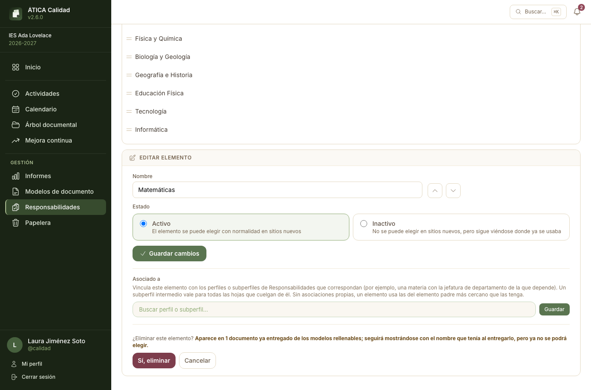
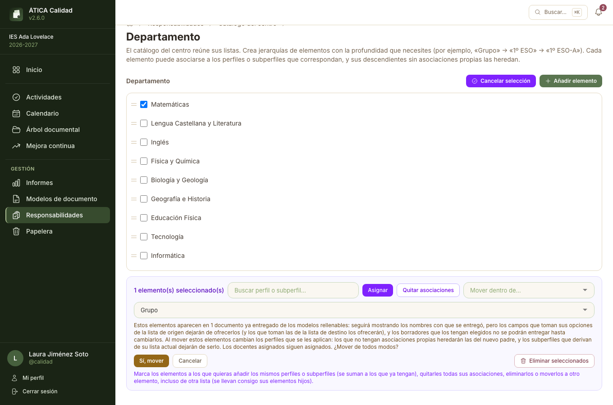
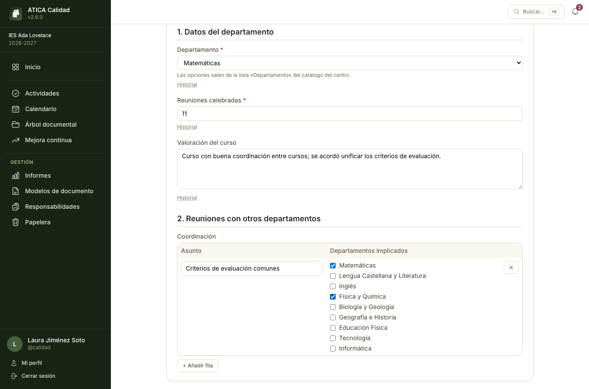
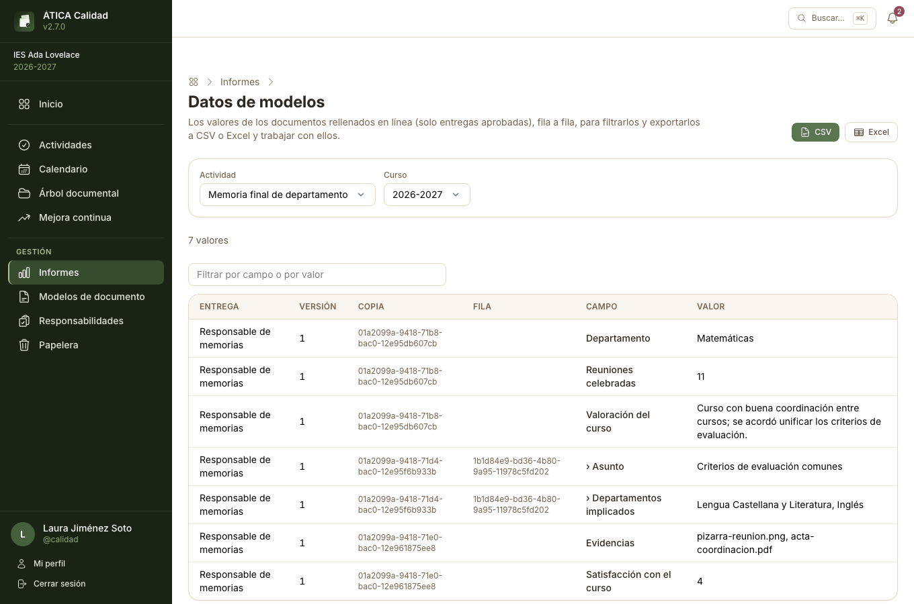

# Modelos de documento

Un **modelo de documento** es un documento con estructura —secciones, textos, campos y tablas— que se
**rellena en línea** en vez de descargarlo, completarlo en un procesador de textos y volver a subirlo.
Sirve para las fichas, actas, memorias y formularios que el centro repite cada curso: quien lo rellena
ve el mismo documento que verá quien lo revise, con los totales calculados, los datos del curso
anterior ya puestos y la entrega guardada como PDF en el árbol documental.

Quien gestiona la calidad (responsable de calidad, equipo directivo o administración del centro)
define los modelos en **Gestión → Modelos de documento**; el resto del profesorado solo los rellena.

> Este capítulo no lleva capturas de pantalla todavía: se añadirán con el resto del manual en cuanto
> se regeneren con los datos de demostración.

## Cómo encaja con lo demás

- Un modelo **es un documento del árbol documental**: vive en una carpeta, tiene versiones
  («revisiones») y pasa por la revisión de esa carpeta como cualquier documento. Su PDF en blanco es lo
  que ve quien lo busca en el árbol.
- Un documento rellenado **no se crea suelto**: nace como la **entrega de una actividad** que, en
  lugar de «Subiendo un fichero», se entrega **rellenando un modelo** (campo *Cómo se entrega* de la
  actividad). Se guarda en la carpeta de la actividad como un PDF y pasa por su revisión.
- Cada documento rellenado recuerda **con qué revisión del modelo** se hizo: si el modelo cambia
  después, lo ya entregado se sigue viendo tal como se entregó.

## Crear y editar un modelo

En **Modelos de documento** escribe el nombre, el código que irá en la cabecera del PDF (por
ejemplo `MD850703`) y la carpeta, y pulsa **Crear y editar**. El editor guarda el borrador solo mientras
escribes; si otra persona o pestaña guarda a la vez, te avisa en vez de pisar sus cambios.

Un modelo se compone de **secciones** (numeradas jerárquicamente, anidables) con estos bloques:

- **Texto**: fijo (no se toca), de partida (se adapta) o a rellenar, con formato.
- **Campo**: texto corto o largo, número (con mínimo, máximo y unidad), fecha, hora, sí/no, una o
  varias opciones, o un valor **calculado** a partir de los demás.
- **Tabla** de filas libres (quien rellena añade las que necesite, con un máximo), de filas fijas, o
  de **doble entrada** (las filas son las de una tabla y las columnas las de otra).

Además:

- **Repetición**: una sección puede repetirse una vez por fila de una tabla, tantas veces como diga un
  número, o las que quiera añadir quien rellena (por ejemplo, una por grupo).
- **Condiciones**: una sección o un bloque solo se muestra si otro campo está lleno, vacío o vale lo
  que se indica.
- **Referencias** `{ }`: en títulos y textos se puede insertar el valor de un campo, el número de copia
  o datos del contexto (centro, curso, actividad, fecha).
- **Cálculos**: fórmulas con suma, media, mínimo, máximo, recuento y operaciones, totales al pie de
  las columnas y **reglas de coherencia** que, si no se cumplen, impiden la entrega (con el mensaje
  que escribas).
- **Columnas de relación**: una columna cuyas opciones son las filas de otra tabla.
- **Ayuda** en cada campo, que se ve al rellenar pero no se imprime.

El botón **Vista previa** muestra el modelo en blanco, tal como se verá.

### Opciones que salen de una lista del catálogo {#opciones-desde-listas}

Un campo de una o varias opciones (o una columna de tabla con ese tipo) puede tener sus opciones
**escritas en el modelo** o **tomadas de una lista del [catálogo del centro](06-responsabilidades.md#catalogo-del-centro)**
(departamentos, grupos, materias…): en *Opciones* se elige **De una lista del catálogo** y la lista, que
puede ser una lista entera o una rama («Enseñanza › FP»). Las opciones son las **hojas** de esa lista,
en su orden, y cada una se llama por su ruta bajo el elemento elegido («Ciencias › Física»); los
elementos inactivos no se ofrecen.

Las opciones **no se copian al modelo: se leen de la lista cada vez que alguien rellena**, igual que
las actividades siguen al catálogo. Un elemento nuevo aparece solo, uno renombrado cambia de nombre y
uno desactivado deja de ofrecerse, sin tocar el modelo ni crear una revisión nueva. Qué ocurre con lo
ya rellenado:

- **Un borrador conserva lo elegido** aunque el elemento ya no se ofrezca (se desactivó, se movió a
  otra lista o se borró): sale marcado como «ya no disponible» o «elemento que ya no existe», y **no se
  puede entregar** hasta elegir otra opción.
- **Un documento entregado conserva los nombres con que se entregó.** Si después renombran o borran el
  elemento, el documento, su PDF, la comparación de revisiones y el explorador de datos siguen diciendo
  lo que decían cuando se aprobó. En los indicadores, agrupar por un campo así muestra esos nombres.
- Un modelo cuya lista **no existe o no tiene ningún elemento activo** no se puede enviar a revisión.
- Las **condiciones** («si el departamento es…») de otros bloques eligen entre los elementos de la
  lista, y siguen funcionando aunque se renombre.

Al **exportar** un modelo a JSON, la lista viaja por sus nombres (no por identificadores del centro); al
**importarlo** en otro centro se enlaza con la lista que tenga **el mismo nombre y la misma ruta**. Si
ese centro no la tiene, el campo queda sin opciones, se avisa de cuáles son y hay que elegir una lista
(o escribir las opciones) antes de enviar el modelo a revisión.

#### Qué avisa Responsabilidades al cambiar una lista

Quitar o mover elementos de una lista afecta a los modelos que la usan, y las pantallas de
[Responsabilidades](06-responsabilidades.md#eliminar-elementos) lo dicen **antes** de hacerlo:

- Al **eliminar** un elemento (o una rama, o una lista entera), la confirmación indica en cuántos
  documentos ya entregados aparece.
- Al **mover** elementos a otro sitio, la confirmación dice lo mismo, y que los campos que toman sus
  opciones de la lista de origen dejarán de ofrecerlos (y los de la lista de destino los ofrecerán).
- Al **importar desde Séneca**, la vista previa avisa del mismo recuento, y un elemento que aparece en
  un documento entregado **no se elimina: se desactiva**, como los que están en uso por otros motivos.

## Aprobación de los documentos rellenados

En el modelo puedes definir **pasos de aprobación**: cada documento entregado se aprueba en ese orden,
y lo decide quien tenga el perfil de cada paso. Sin pasos, lo revisa quien revisa la carpeta; si la
carpeta no tiene revisión, la entrega queda aprobada al instante.

En un documento entregado, quien lo revisa puede **comentar partes concretas** (un campo, una tabla,
una sección), responder y marcar los comentarios como resueltos, y ver **qué ha cambiado** respecto a la
versión anterior, dato por dato.

## Publicar una revisión nueva

**Enviar a revisión** congela el borrador como la revisión siguiente del modelo; cuando se aprueba,
es la que usan las actividades. Si ya hay documentos rellenados con revisiones anteriores, el editor
dice cuántos borradores y entregas se verían afectados y deja elegir:

- **Actualizar es opcional**: cada cual decide si pasa su documento a la revisión nueva.
- **Actualizar es obligatorio** (opcionalmente a partir de una fecha): hay que pasar.

Al **actualizar** un documento a la revisión vigente, lo ya escrito se conserva por la identidad de
cada campo, no por su posición ni su título; si algún dato se pierde porque el campo ya no existe, se
avisa antes. También se puede **empezar de cero**.

## Rellenar un documento

Desde la actividad se abre el documento. Se guarda **solo** mientras escribes y ves en todo momento
cuánto falta para poder entregarlo. Lo que debes saber:

- **Un editor a la vez**: si otra persona está editando el mismo borrador, lo ves en solo lectura
  hasta que acabe (unos minutos sin actividad) o hasta que pulses **Tomar el control**.
- **Prerrellenado**: el borrador nace con lo entregado el curso anterior (o con lo que indique la
  actividad en *Prerrellenar con lo entregado en*): los campos se copian por su identidad si es el
  mismo modelo, o por su nombre interno y tipo si es otro.
- **Borradores para todos**: la actividad puede crear el borrador de todas las personas o grupos al
  abrirse el plazo (*Crear el borrador de todos al abrirse el plazo*), de modo que cada cual lo
  encuentre ya empezado.
- Lo que falta aparece bajo **Pendiente antes de entregar**, cada punto con un enlace al lugar. Al
  **Entregar** se genera el PDF y la entrega entra en la revisión de la carpeta.
- Una entrega rechazada o a corregir se **corrige** con una versión siguiente; las anteriores se
  conservan.

Entregado y aprobado, el documento se ve así, con los departamentos por su nombre y los botones para
bajarlo en PDF, Word u OpenDocument:

### Sin conexión

El formulario sigue funcionando si se corta la conexión, siempre que ese mismo equipo lo haya abierto
antes con conexión: la página se guarda en el navegador y lo que escribas se **conserva en este
equipo** hasta que se pueda guardar, y se envía solo al volver la conexión («Sin conexión: los cambios
se guardarán al volver»). Si al reabrir hay cambios sin guardar, se recuperan y se avisa. Hay que
saber que:

- **Entregar, comentar o aprobar siempre necesitan conexión.**
- Si mientras tanto otra persona guardó el mismo borrador, vale lo guardado en el servidor y lo local
  se descarta.
- Al **cerrar sesión** se borran las páginas guardadas en el navegador. En un equipo compartido,
  cierra siempre la sesión.
- El modo sin conexión solo funciona en conexiones seguras (`https`).

## Sacar los documentos de la aplicación

- **PDF**: el de cada entrega, desde el árbol documental o desde la página del documento rellenado.
- **Word (.docx) y LibreOffice (.odt)**: en la página de un documento entregado (botones **DOCX** y
  **ODT**), y también el modelo en blanco, desde **Modelos de documento → Exportar**.

## Compartir y reutilizar modelos

En **Modelos de documento**:

- **Exportar → JSON (otro centro)** descarga el modelo; **Importar un modelo** lo crea en otro centro
  (o en el mismo) como un **borrador nuevo**, que hay que revisar y enviar a revisión como cualquier
  otro. Los pasos de aprobación no viajan, porque nombran perfiles de un centro concreto.
- **Duplicar** crea una copia del borrador, «Copia de …», para partir de un modelo parecido.
- **Importar desde Word u OpenDocument** (`.docx`, `.odt`) hace un **primer borrador**: los títulos
  pasan a ser secciones, los párrafos textos fijos y las tablas tablas de filas libres cuyas columnas
  son la primera fila. Lo que hay que rellenar (campos, tipos, opciones) se añade después en el
  editor, porque un documento de texto no lo dice.

## Indicadores calculados desde los documentos

Un [indicador](09-mejora-continua.md#indicadores) puede alimentarse de un campo de las entregas
**aprobadas** de una actividad (solo cuenta la última versión aprobada de cada entrega). En el
editor del modelo, **Indicadores con los datos de este modelo** ofrece un botón por campo numérico, de
sí/no, de opciones o calculado; también se elige en el formulario del indicador, sección *Calculado
desde documentos*.

- Se puede **sumar, promediar, tomar el mínimo o el máximo, contar**, contar o sacar el **porcentaje de
  los que cumplen una condición**, o dividir un campo por otro (×100). Si el campo es de opciones, la
  condición se **elige de una lista con buscador** (escribe para filtrar), con las opciones tal como
  están ahora: no hace falta conocer ningún código.

- **Desglose**: el valor global y, además, el de cada entrega (perfil o docente) o de cada opción de un
  campo. Si un grupo queda por debajo del umbral aunque el global cumpla, se puede **abrir un
  hallazgo solo de ese grupo**.
- La medición dice **con cuántas entregas** se ha calculado y cuántas se esperaban.
- Se recalcula al **aprobarse una entrega** y a diario con la tarea programada
  `app:forms:calculate-indicators`. Un valor tecleado a mano, o uno del que ya se decidió qué hacer,
  **nunca se sobrescribe**.

## Datos de modelos (Informes)

**Informes → Datos de modelos** lista, fila a fila, los valores de las entregas aprobadas de una
actividad y un curso (entrega, versión, copia, fila, campo y valor), con un filtro de texto en
pantalla y **exportación completa a CSV y Excel**. Lo ve quien puede ver los demás informes.

## Permisos, de un vistazo

| Puede... | Docente | Responsable de calidad / equipo directivo / admin. del centro |
| --- | :-: | :-: |
| Rellenar y entregar los documentos de sus actividades | ✅ | ✅ |
| Descargar sus entregas en PDF, Word y OpenDocument | ✅ | ✅ |
| Crear, editar, duplicar, importar y exportar modelos | — | ✅ |
| Decidir un paso de aprobación | quien tenga el perfil del paso | ✅ (si gestiona la carpeta) |
| Consultar «Datos de modelos» y crear indicadores calculados | — | ✅ |
