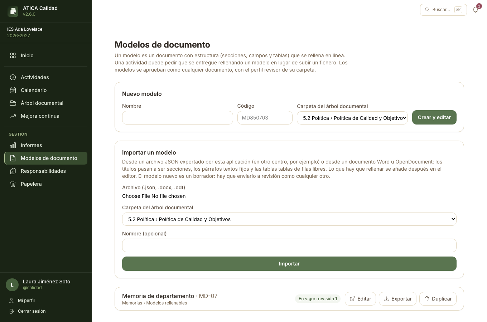
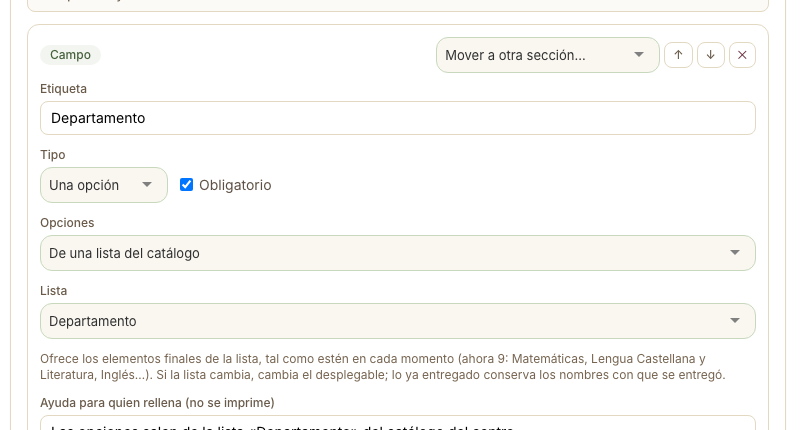
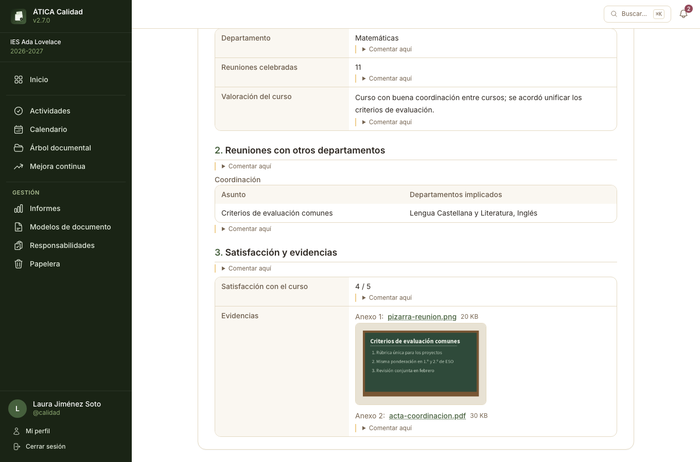

# Modelos de documento

Un **modelo de documento** es un documento con estructura —secciones, textos, campos y tablas— que se
**rellena en línea** en vez de descargarlo, completarlo en un procesador de textos y volver a subirlo.
Sirve para las fichas, actas, memorias y formularios que el centro repite cada curso: quien lo rellena
ve el mismo documento que verá quien lo revise, con los totales calculados, los datos del curso
anterior ya puestos y la entrega guardada como PDF en el árbol documental.

Quien gestiona la calidad (responsable de calidad, equipo directivo o administración del centro)
define los modelos en **Gestión → Modelos de documento**; el resto del profesorado solo los rellena.

> Este capítulo no lleva capturas de pantalla todavía: se añadirán con el resto del manual en cuanto
> se regeneren con los datos de demostración.

## Cómo encaja con lo demás

- Un modelo **es un documento del árbol documental**: vive en una carpeta, tiene versiones
  («revisiones») y pasa por la revisión de esa carpeta como cualquier documento. Su PDF en blanco es lo
  que ve quien lo busca en el árbol.
- Un documento rellenado **no se crea suelto**: nace como la **entrega de una actividad** que, en
  lugar de «Subiendo un fichero», se entrega **rellenando un modelo** (campo *Cómo se entrega* de la
  actividad). Se guarda en la carpeta de la actividad como un PDF y pasa por su revisión.
- Cada documento rellenado recuerda **con qué revisión del modelo** se hizo: si el modelo cambia
  después, lo ya entregado se sigue viendo tal como se entregó.

## Crear y editar un modelo

En **Modelos de documento** pulsa **Nuevo modelo**; en la ventana que se abre escribe el nombre, el código
que irá en la cabecera del PDF (por ejemplo `MD850703`) y la carpeta (el desplegable permite buscarla
escribiendo), y pulsa **Crear y editar**. El editor guarda el borrador solo mientras
escribes; si otra persona o pestaña guarda a la vez, te avisa en vez de pisar sus cambios.

El editor se organiza en **pestañas**: *Contenido* (con el índice a la izquierda), *Reglas de coherencia*,
*Pasos de aprobación* e *Indicadores* (esta última solo si el modelo tiene campos que ofrecer). Cada pestaña
muestra su estado: un **punto ámbar** si esa parte difiere de la última revisión enviada y un **número
rojo** con los problemas que impiden enviarla. Encima de las pestañas, una **barra fija** dice si hay
cambios sin enviar y tiene el botón de envío.

La lista de modelos tiene un **buscador** (nombre, código o carpeta) y filtros por **estado** (en vigor, sin
revisión aprobada, pendiente de aprobar o con cambios en el borrador sin enviar) y por **sección** del árbol
documental. Se puede **ordenar** por nombre, código, última modificación o estado, y **agrupar** por sección
o por estado (cada grupo se pliega pulsando su título). El botón ámbar **Necesitan atención** filtra los
modelos con una revisión pendiente de aprobar o con cambios sin enviar. Con muchos modelos, la lista
muestra 50 cada vez y ofrece **Mostrar más**. Exportar y Duplicar están en el menú **⋯** de cada fila; el
orden y la agrupación elegidos se recuerdan en el navegador.

Un modelo se compone de **secciones** (numeradas jerárquicamente, anidables) con estos bloques:

- **Texto**: fijo (no se toca), de partida (se adapta) o a rellenar, con formato.
- **Campo**: texto corto, texto largo (con **formato enriquecido**: negrita, cursiva, listas,
  enlaces…; en las celdas de una tabla sigue siendo texto plano), número (con mínimo, máximo y unidad), fecha, hora, sí/no, una o
  varias opciones, **escala de valoración**, **adjuntos** o un valor **calculado** a partir de los demás.
- **Adjuntos**: archivos que acompañan al documento como evidencia (un acta, una foto, una hoja de
  cálculo). El modelo dice cuántos admite el campo (de 1 a 10; 5 si no se dice otra cosa). Se aceptan
  PDF, imágenes, documentos de oficina y texto, de hasta 10 MB cada uno (menos si el servidor limita
  las subidas); el tipo se comprueba por el contenido, no por el nombre. Solo en campos, no en las
  celdas de una tabla. Al rellenar, se eligen o se arrastran sobre el recuadro, y se suben al momento
  (hace falta conexión). En el documento cada archivo es un **«Anexo N»** numerado:
  - en la vista web se descarga pulsando su nombre, y las imágenes se ven en su sitio;
  - en el **PDF entregado**, las imágenes se dibujan en su sitio, al final hay una lista de anexos y
    los archivos originales **van dentro del PDF** (se abren desde el panel de archivos adjuntos del
    lector de PDF); si el campo lo pide («Incluir las páginas de los PDF adjuntos»), las páginas de
    cada PDF adjunto se añaden al final;
  - **Documento con anexos (ZIP)**, en la página del documento entregado, descarga el PDF y una
    carpeta `anexos/` con los archivos numerados igual que en el documento;
  - en Word y LibreOffice aparece la referencia de cada anexo («Anexo 1: acta.pdf (230 KB)») y las
    imágenes (PNG y JPEG) se ven debajo del campo, con su pie; los demás archivos no caben en esos
    formatos y quedan solo como referencia.

  Los anexos se congelan con cada entrega: corregir el documento crea otra versión y la anterior
  conserva los suyos. Un archivo que solo está en el borrador lo ve solo quien rellena; uno entregado,
  quien puede ver la carpeta del documento.

  
- **Escala de valoración**: una respuesta de 1 a N puntos (de 3 a 10; 5 si no se dice otra cosa), con
  una palabra opcional para cada extremo («Nada» … «Mucho»). Se contesta pulsando el número (en una
  tabla, en un desplegable) y se lee como «4 / 5». Cuenta como un número: sirve en fórmulas, en el
  total al pie (la **media** de una columna de valoraciones) y en los indicadores, que proponen la
  media. En el modelo en blanco se imprimen los puntos para marcarlos a mano. Una tabla de filas
  fijas con una columna de escala es una encuesta: una fila por pregunta.
- **Resumen de la fila**: en una columna calculada de una tabla, el recuadro «Resumen de la fila»
  calcula la suma, la media, el mínimo, el máximo o cuántas tienen algo de las columnas que marques
  **de la misma fila** (por ejemplo, «Total» = «Horas teoría» + «Horas práctica»), sin escribir la
  fórmula. Escribe una fórmula normal, que puedes seguir retocando a mano.
- **Total al pie de una columna** numérica o calculada (cuenta, suma, media, mínimo o máximo): el
  valor se ve al final de la columna. Si le pones un **nombre**, además es un campo del documento
  (no se muestra aparte: está solo al pie de la tabla) y sirve en fórmulas, indicadores, reglas y
  en el explorador de datos. «Cuenta» cuenta los valores rellenados, no las filas. Eliges qué valor
  mostrar columna a columna (o ninguno) y, con **Personalizado**, escribes tú la fórmula del total
  (por ejemplo, máximo menos mínimo); un total personalizado es siempre un campo del documento.
- **Tabla** de filas libres (quien rellena añade las que necesite, con un máximo), de filas fijas, de
  **tantas filas como diga un campo** (se elige un campo numérico del modelo, por ejemplo «Reuniones
  celebradas»: la tabla tiene esas filas, numeradas, y quien rellena no las añade ni las quita) o de
  **doble entrada** (las filas son las de una tabla y las columnas las de otra).

  En la tabla según un campo, si el número sube se añaden filas en blanco al final; si baja, se
  quitan las últimas, y antes de hacerlo la pantalla avisa cuando alguna de esas filas tiene algo
  escrito. Se puede poner un máximo de filas (hasta 100), que prevalece sobre el número.

Además:

- **Repetición**: una sección puede repetirse una vez por fila de una tabla, tantas veces como diga un
  número, o las que quiera añadir quien rellena (por ejemplo, una por grupo).
- **Condiciones**: una sección o un bloque solo se muestra si otro campo está lleno, vacío o vale lo
  que se indica.
- **Referencias** `{ }`: en títulos y textos se puede insertar el valor de un campo, el número de copia
  o datos del contexto (centro, curso, actividad, fecha).
- **Cálculos**: fórmulas con suma, media, mínimo, máximo, recuento y operaciones, totales al pie de
  las columnas y **reglas de coherencia** que, si no se cumplen, impiden la entrega (con el mensaje
  que escribas).
- **Columnas de relación**: una columna cuyas opciones son las filas de otra tabla.
- **Ayuda** en cada campo, que se ve al rellenar pero no se imprime.

El botón **Vista previa** muestra el modelo en blanco, tal como se verá.

### Opciones que salen de una lista del catálogo {#opciones-desde-listas}

Un campo de una o varias opciones (o una columna de tabla con ese tipo) puede tener sus opciones
**escritas en el modelo** o **tomadas de una lista del [catálogo del centro](06-responsabilidades.md#catalogo-del-centro)**
(departamentos, grupos, materias…): en *Opciones* se elige **De una lista del catálogo** y la lista, que
puede ser una lista entera o una rama («Enseñanza › FP»). Las opciones son las **hojas** de esa lista,
en su orden, y cada una se llama por su ruta bajo el elemento elegido («Ciencias › Física»); los
elementos inactivos no se ofrecen.

Las opciones **no se copian al modelo: se leen de la lista cada vez que alguien rellena**, igual que
las actividades siguen al catálogo. Un elemento nuevo aparece solo, uno renombrado cambia de nombre y
uno desactivado deja de ofrecerse, sin tocar el modelo ni crear una revisión nueva. Qué ocurre con lo
ya rellenado:

- **Un borrador conserva lo elegido** aunque el elemento ya no se ofrezca (se desactivó, se movió a
  otra lista o se borró): sale marcado como «ya no disponible» o «elemento que ya no existe», y **no se
  puede entregar** hasta elegir otra opción.
- **Un documento entregado conserva los nombres con que se entregó.** Si después renombran o borran el
  elemento, el documento, su PDF, la comparación de revisiones y el explorador de datos siguen diciendo
  lo que decían cuando se aprobó. En los indicadores, agrupar por un campo así muestra esos nombres.
- Un modelo cuya lista **no existe o no tiene ningún elemento activo** no se puede enviar a revisión.
- Las **condiciones** («si el departamento es…») de otros bloques eligen entre los elementos de la
  lista, y siguen funcionando aunque se renombre.

Al **exportar** un modelo a JSON, la lista viaja por sus nombres (no por identificadores del centro); al
**importarlo** en otro centro se enlaza con la lista que tenga **el mismo nombre y la misma ruta**. Si
ese centro no la tiene, el campo queda sin opciones, se avisa de cuáles son y hay que elegir una lista
(o escribir las opciones) antes de enviar el modelo a revisión.

#### Qué avisa Responsabilidades al cambiar una lista

Quitar o mover elementos de una lista afecta a los modelos que la usan, y las pantallas de
[Responsabilidades](06-responsabilidades.md#eliminar-elementos) lo dicen **antes** de hacerlo:

- Al **eliminar** un elemento (o una rama, o una lista entera), la confirmación indica en cuántos
  documentos ya entregados aparece.
- Al **mover** elementos a otro sitio, la confirmación dice lo mismo, y que los campos que toman sus
  opciones de la lista de origen dejarán de ofrecerlos (y los de la lista de destino los ofrecerán).
- Al **importar desde Séneca**, la vista previa avisa del mismo recuento, y un elemento que aparece en
  un documento entregado **no se elimina: se desactiva**, como los que están en uso por otros motivos.

## Aprobación de los documentos rellenados

En el modelo puedes definir **pasos de aprobación**: cada documento entregado se aprueba en ese orden,
y lo decide quien tenga el perfil de cada paso. Sin pasos, lo revisa quien revisa la carpeta; si la
carpeta no tiene revisión, la entrega queda aprobada al instante.

En un documento entregado, quien lo revisa puede **comentar partes concretas** (un campo, una tabla,
una sección), responder y marcar los comentarios como resueltos, y ver **qué ha cambiado** respecto a la
versión anterior, dato por dato.

## Publicar una revisión nueva

**Enviar a revisión** (en la barra fija del editor; si la carpeta no exige revisión, el botón dice
**Guardar como nueva revisión**) congela el borrador como la revisión siguiente del modelo; cuando se
aprueba, es la que usan las actividades. El botón se desactiva mientras no haya cambios respecto a la última
revisión enviada, y el panel que abre lista los problemas pendientes, con un enlace a su pestaña. Si ya hay documentos rellenados con revisiones anteriores, el editor
dice cuántos borradores y entregas se verían afectados y deja elegir:

- **Actualizar es opcional**: cada cual decide si pasa su documento a la revisión nueva.
- **Actualizar es obligatorio** (opcionalmente a partir de una fecha): hay que pasar.

Al **actualizar** un documento a la revisión vigente, lo ya escrito se conserva por la identidad de
cada campo, no por su posición ni su título; si algún dato se pierde porque el campo ya no existe, se
avisa antes. También se puede **empezar de cero**.

## Rellenar un documento

Desde la actividad se abre el documento. Se guarda **solo** mientras escribes y ves en todo momento
cuánto falta para poder entregarlo. Lo que debes saber:

- **Un editor a la vez**: si otra persona está editando el mismo borrador, lo ves en solo lectura
  hasta que acabe (unos minutos sin actividad) o hasta que pulses **Tomar el control**.
- **Prerrellenado**: el borrador nace con lo entregado el curso anterior (o con lo que indique la
  actividad en *Prerrellenar con lo entregado en*): los campos se copian por su identidad si es el
  mismo modelo, o por su nombre interno y tipo si es otro.
- **Borradores para todos**: la actividad puede crear el borrador de todas las personas o grupos al
  abrirse el plazo (*Crear el borrador de todos al abrirse el plazo*), de modo que cada cual lo
  encuentre ya empezado.
- Los desplegables se pueden **filtrar escribiendo**, y una pregunta de varias opciones se elige en
  un desplegable y se muestra con **etiquetas** que se quitan con la ×. Un número con mínimo o máximo
  se marca en rojo en cuanto se sale de los límites.
- Lo que falta aparece bajo **Pendiente antes de entregar**, cada punto con un enlace al lugar. Cada
  dato obligatorio vacío o inválido se marca **en rojo, con su mensaje, en el propio campo**: al salir
  de él, o todos a la vez al pulsar un punto de la lista. **Previsualizar** abre en otra pestaña el
  borrador tal y como quedará entregado, sin entregar nada. Al **Entregar** se genera el PDF y la
  entrega entra en la revisión de la carpeta.
- Una entrega rechazada o a corregir se **corrige** con una versión siguiente; las anteriores se
  conservan.

Más abajo, en la sección 3, la **escala de valoración** se contesta pulsando un número, y los
**adjuntos** se eligen o se arrastran sobre el recuadro; cada archivo subido aparece en la lista, con
su tamaño y una ✕ para quitarlo:

Entregado y aprobado, el documento se ve así, con los departamentos por su nombre y los botones para
bajarlo en PDF, Word u OpenDocument y, como tiene archivos adjuntos, **Documento con anexos (ZIP)**:

En la sección 3 se lee la satisfacción como «4 / 5» y cada archivo adjunto es un **anexo** numerado,
que se descarga pulsando su nombre; las imágenes se ven en su sitio:

### Sin conexión

El formulario sigue funcionando si se corta la conexión, siempre que ese mismo equipo lo haya abierto
antes con conexión: la página se guarda en el navegador y lo que escribas se **conserva en este
equipo** hasta que se pueda guardar, y se envía solo al volver la conexión («Sin conexión: los cambios
se guardarán al volver»). Si al reabrir hay cambios sin guardar, se recuperan y se avisa. Hay que
saber que:

- **Entregar, comentar o aprobar siempre necesitan conexión.**
- Si mientras tanto otra persona guardó el mismo borrador, vale lo guardado en el servidor y lo local
  se descarta.
- Al **cerrar sesión** se borran las páginas guardadas en el navegador. En un equipo compartido,
  cierra siempre la sesión.
- El modo sin conexión solo funciona en conexiones seguras (`https`).

## Encabezado, pie de página y formato {#encabezado-y-pie}

Cada página de un documento (PDF, Word y LibreOffice) lleva un **encabezado** arriba y un **pie** abajo. Son
texto enriquecido con **tablas** (celdas combinadas, líneas, colores de fondo), y pueden incluir estos
**campos**, que la aplicación rellena al generar cada documento. Se insertan con el desplegable «Insertar
campo» del editor, o escribiéndolos entre llaves:

| Campo | Qué pone |
|---|---|
| `{centro}` | El nombre del centro |
| `{localidad}` | La localidad del centro |
| `{logo}` | El logotipo del centro (una imagen) |
| `{logo2}` | El logotipo de la administración educativa de la que depende el centro (por ejemplo, la Junta de Andalucía) |
| `{pagina}` y `{paginas}` | El número de la página y el total de páginas |
| `{codigo}` | El código del documento (el del modelo, por ejemplo `MD850211`) |
| `{titulo}` | El título del modelo |
| `{revision}` | El número de la revisión del modelo |
| `{fecha_revision}` | La fecha en que se hizo esa revisión (en un borrador, la de hoy) |
| `{fecha_aprobacion}` | La fecha en que se aprobó. Si el modelo no necesita revisión, es la misma que `{fecha_revision}` |

Los logotipos se suben en **Ajustes → Documentos: logotipos, encabezado, pie y márgenes**, como imágenes PNG
o JPEG de hasta 2 MB: la plataforma puede poner los suyos y cada centro sustituirlos por los propios. Se
dibujan con una altura de hasta 1,6 cm (y 5 cm de ancho), sin deformarse. Si no hay imagen, el campo no
pone nada.

El encabezado y el pie **predeterminados** son una tabla como la de los documentos del centro: el logotipo del
centro a la izquierda y el de la administración educativa a la derecha (ocupando las tres filas), y entre ellos el
nombre y la localidad, el título, y en la última fila el código, la revisión y «Página x de y»; al pie, el código y
la fecha. Se cambian en esos mismos ajustes: la plataforma
tiene los suyos y cada centro puede poner los propios. Debajo de cada editor hay una **vista previa con datos de
ejemplo** (el nombre, la localidad y los logotipos del centro), que se actualiza mientras se escribe.

Cada modelo puede además personalizarlos en su pestaña **Ajustes**, donde también se elige:

- **Encabezado de la primera página**: por defecto es el mismo que el de las demás; si se activa «Distinto en la
  primera página», se edita aparte (por ejemplo, para poner ahí los logotipos).
- **Márgenes**: superior (hasta el encabezado), derecho, inferior (hasta el pie) e izquierdo, en milímetros.
  El centro y la plataforma tienen los suyos en los ajustes; el contenido empieza siempre debajo del
  encabezado y termina encima del pie, sea cual sea su altura.
- **Orientación de la página**: vertical o apaisado.
- **Tamaño del contenido**: un deslizador del 50 % al 150 % (el 100 % es el tamaño normal) para reducir o
  ampliar el texto del documento; el encabezado y el pie no cambian de tamaño.

Todo esto forma parte de la **revisión** del modelo, igual que el contenido: la pestaña muestra un punto
ámbar mientras difiera de la última revisión enviada, y los documentos ya entregados conservan el aspecto
con el que se entregaron. Si el modelo no personaliza el encabezado o el pie, usa el del centro: en los PDF
ya entregados no cambia nada, pero en las exportaciones a Word y LibreOffice, que se generan al pedirlas,
se verá el que haya entonces en los ajustes. El botón **Vista previa en PDF** del editor enseña el
documento tal como saldrá, con su encabezado, pie, márgenes, orientación y tamaño, y con una marca de agua
«BORRADOR», porque es la vista de un borrador.

El PDF en blanco que se guarda al enviar una revisión a aprobación se genera en ese momento, así que mientras la
revisión está pendiente `{fecha_aprobacion}` sale vacío en él (todavía no hay fecha). Cuando se aprueba, el PDF se
genera de nuevo y ya lleva la fecha de aprobación. Los documentos rellenados y las exportaciones a Word y LibreOffice
llevan siempre la fecha de aprobación real.

## Sacar los documentos de la aplicación

- **PDF**: el de cada entrega, desde el árbol documental o desde la página del documento rellenado.
- **Word (.docx) y LibreOffice (.odt)**: en la página de un documento entregado (botones **DOCX** y
  **ODT**), y también el modelo en blanco, desde **Modelos de documento → Exportar**. Salen con el estilo de
  la aplicación (títulos en verde, tablas con cabecera de color y filas alternas, listas de campos con la
  etiqueta resaltada), el encabezado y el pie en el de página de Word o LibreOffice (se repiten en cada hoja, con
  el número de página real), y la orientación y el tamaño del modelo.

## Compartir y reutilizar modelos

En **Modelos de documento**:

- **Exportar → JSON (otro centro)** descarga el modelo; **Importar** (arriba a la derecha; el archivo se suelta en la zona de arrastre) lo crea en otro centro
  (o en el mismo) como un **borrador nuevo**, que hay que revisar y enviar a revisión como cualquier
  otro. Los pasos de aprobación no viajan, porque nombran perfiles de un centro concreto.
- **Duplicar** crea una copia del borrador, «Copia de …», para partir de un modelo parecido.
- **Importar desde Word u OpenDocument** (`.docx`, `.odt`) hace un **primer borrador**: los títulos
  pasan a ser secciones, los párrafos textos fijos y las tablas tablas de filas libres cuyas columnas
  son la primera fila. Lo que hay que rellenar (campos, tipos, opciones) se añade después en el
  editor, porque un documento de texto no lo dice.

## Indicadores calculados desde los documentos

Un [indicador](09-mejora-continua.md#indicadores) puede alimentarse de un campo de las entregas
**aprobadas** de una actividad (solo cuenta la última versión aprobada de cada entrega). En el
editor del modelo, la pestaña **Indicadores** lista los **indicadores ya asociados al modelo**, cada
uno con un enlace a su ficha, y **Indicadores con los datos de este modelo** ofrece un botón por campo numérico, de
sí/no, de opciones o calculado; también se elige en el formulario del indicador, sección *Calculado
desde documentos*.

- Se puede **sumar, promediar, tomar el mínimo o el máximo, contar**, contar o sacar el **porcentaje de
  los que cumplen una condición**, o dividir un campo por otro (×100). Si el campo es de opciones, la
  condición se **elige de una lista con buscador** (escribe para filtrar), con las opciones tal como
  están ahora: no hace falta conocer ningún código.

- **Desglose**: el valor global y, además, el de cada entrega (perfil o docente) o de cada opción de un
  campo. Si un grupo queda por debajo del umbral aunque el global cumpla, se puede **abrir un
  hallazgo solo de ese grupo**.
- La medición dice **con cuántas entregas** se ha calculado y cuántas se esperaban.
- Se recalcula al **aprobarse una entrega** y a diario con la tarea programada
  `app:forms:calculate-indicators`. Un valor tecleado a mano, o uno del que ya se decidió qué hacer,
  **nunca se sobrescribe**.

## Datos de modelos (Informes)

**Informes → Datos de modelos** lista, fila a fila, los valores de las entregas aprobadas de una
actividad y un curso (entrega, versión, copia, fila, campo y valor), con un filtro de texto en
pantalla y **exportación completa a CSV y Excel**. Lo ve quien puede ver los demás informes.

## Permisos, de un vistazo

| Puede... | Docente | Responsable de calidad / equipo directivo / admin. del centro |
| --- | :-: | :-: |
| Rellenar y entregar los documentos de sus actividades | ✅ | ✅ |
| Descargar sus entregas en PDF, Word y OpenDocument | ✅ | ✅ |
| Crear, editar, duplicar, importar y exportar modelos | — | ✅ |
| Decidir un paso de aprobación | quien tenga el perfil del paso | ✅ (si gestiona la carpeta) |
| Consultar «Datos de modelos» y crear indicadores calculados | — | ✅ |
